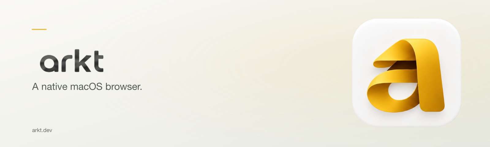

<picture>
  <source media="(prefers-color-scheme: dark)" srcset="design/brand/social/readme-header-dark.png">
  
</picture>

# Arkt

Arkt is a native macOS browser that rebuilds the Arc experience: the sidebar with Spaces, pinned and Today tabs,
Favorites, the command bar, Split View, Little Arc style windows, auto-archive and Peek, plus an importer for your
existing Arc data. The Browser Company sunsets Arc on 2026-12-22; Arkt aims to be a faithful, fast home for Arc users
after that date.

Arkt is built on its own Chromium framework: the window, sidebar and every hot path are native AppKit at 120 Hz. It is not a CEF wrapper and
not a WKWebView shell, so full Chrome extension support (Web Store, password managers) is part of the design.

**Status: pre-alpha.** Nothing here is ready for daily use yet.

## Repository layout

| Path | What it is |
|---|---|
| `app/ArktCore` | SwiftPM package: sidebar model, Arc import, persistence (GRDB), archive and auto-archive policy |
| `app/ArktShell` | The native app shell: XcodeGen project (`project.yml`) plus the `ShellKit` package (window chrome, sidebar, command bar, motion, theme) |
| `engine/` | The Chromium side: our overlay sources (`engine/arkt`, linked into the checkout as `//arkt`), the upstream patch set (`engine/patches/chromium`) and the patch workflow |
| `docs/plans` | Design, implementation plans and results |
| `docs/spec` | The Arc 1.168 parity spec (shortcuts, behaviors, settings) |

## Building the shell

Requirements: macOS 15 or later, Xcode with Swift 6, [XcodeGen](https://github.com/yonaskolb/XcodeGen).

```zsh
# Core model and import
cd app/ArktCore && swift test

# Shell UI package (GUI tests need a logged-in session; skip them in headless runs)
cd app/ArktShell/ShellKit && swift test --skip ShellKitGUITests

# The app (the .xcodeproj is generated, never committed)
cd app/ArktShell && xcodegen generate
xcodebuild -project ArktShell.xcodeproj -scheme ArktShell -configuration Debug -derivedDataPath build build
```

The shell currently runs against a test engine (`FakeEngine`, WKWebView-backed) so the UI can be developed without a
Chromium build.

## Building the engine

The engine is a Chromium checkout pinned to 156.0.8078.48 with our overlay linked in and our patches applied on a
local branch. It needs a full Chromium toolchain (depot_tools) and a lot of disk and time. The steps (define
`$CHROMIUM_ROOT`, link the overlay, apply and export patches) are in [engine/README.md](engine/README.md).

## Clean room

Arkt is an independent implementation. Arc's behavior is matched from its documentation, its observable UI and its
on-disk data formats (for import). No Arc code or assets are copied. Arkt is not affiliated with, endorsed by or connected to The Browser
Company. "Arc" is a trademark of its owner and is used here only to describe compatibility.

## License

MIT, see [LICENSE](LICENSE). Chromium is licensed separately under its own terms.
