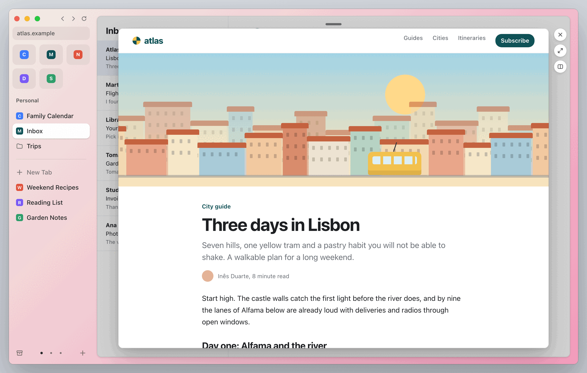
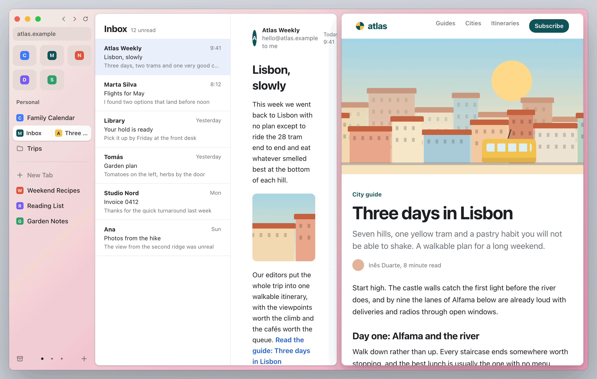
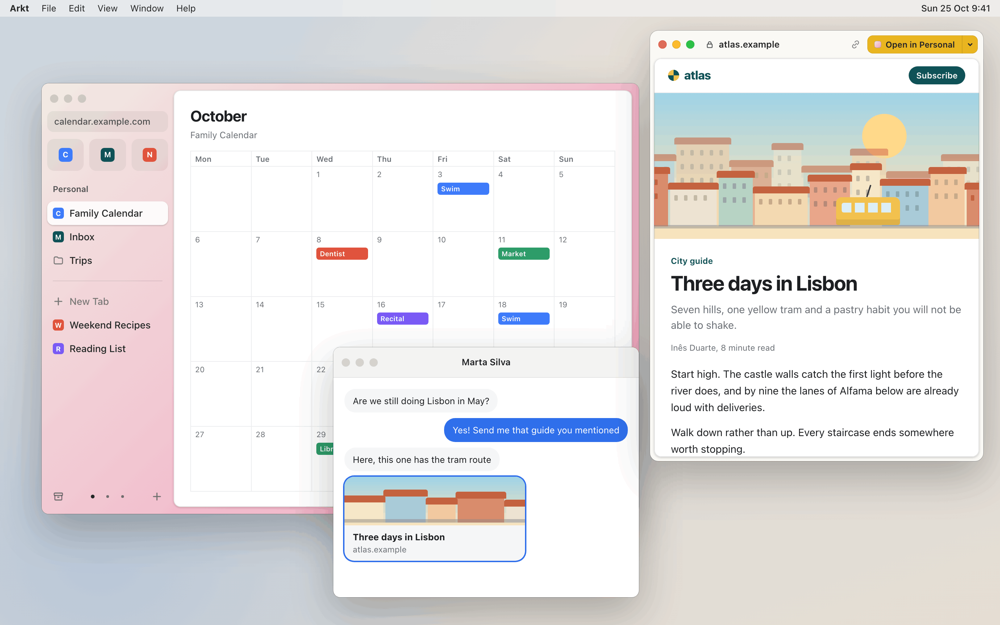
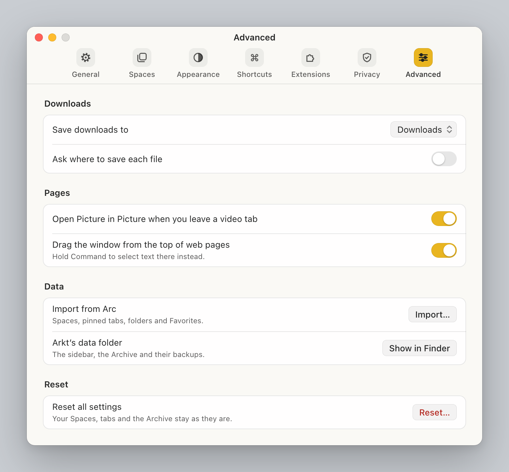

<p align="center">
  <a href="https://arkt.dev">
    
  </a>
</p>

<h1 align="center">arkt</h1>

<p align="center"><strong>Keep the way you browse.</strong></p>

<p align="center">
  Arkt is a native macOS browser built around a familiar sidebar: Spaces, pinned tabs and Today,<br>
  with a path to bring your Arc data across.
</p>

<p align="center">
  <a href="https://arkt.dev">Official website: arkt.dev</a> ·
  <a href="https://arkt.dev/#get">Join the waitlist</a> ·
  <a href="CONTRIBUTING.md">Contributing</a> ·
  <a href="https://buymeacoffee.com/krystianslowik">Buy me a coffee</a>
</p>

**Pre-alpha. Not ready for daily use.** [Join the waitlist](https://arkt.dev/#get) to hear when Arkt is ready for you.

## Download the preview

The first preview build is on the [Releases page](https://github.com/krystianslowik/arkt/releases). It is early
software and not signed or notarized, so macOS blocks it on first open.

Requirements: a Mac with Apple silicon and macOS 15 or later.

1. Download `Arkt-<version>-arm64.zip` from the latest release and unzip it.
2. Move `Arkt.app` to `/Applications`.
3. Open it. macOS shows a warning and does not open it. On macOS 15, Control-click > Open no longer bypasses
   Gatekeeper. Either:
   - Open **System Settings > Privacy & Security**, scroll to the message about Arkt and click **Open Anyway**; or
   - Remove the quarantine flag in Terminal, then open the app:

         xattr -dr com.apple.quarantine /Applications/Arkt.app

   If the warning is still on screen, click **Done** on it before you run the command (never Move to Trash).

The first launch is slower than later ones while macOS checks the app. See the release notes for what the preview
includes and how to report problems.

## Interface previews

Captures of Arkt’s interactive design prototypes. Features and details may change during implementation.

<p align="center">
  <a href="design/readme/screens/peek-open-light.png">
    <picture>
      <source media="(prefers-color-scheme: dark)" srcset="design/readme/screens/peek-open-dark.png">
      
    </picture>
  </a>
</p>

## What we're building

The goal is to preserve the habits you already have in Arc:

- Spaces, Favorites and pinned folders keep the sidebar organized; Today tabs archive themselves.
- Split View, Peek and small companion windows let you follow a link without losing your place.
- A command bar opens tabs, links and searches; an importer brings your existing Arc structure across.
- An AppKit shell surrounds Arkt's Chromium framework, with Chrome extensions as part of the design.

This is the product direction, not a list of release-ready features. The [roadmap](https://github.com/krystianslowik/arkt/issues/30)
and [implementation plans](docs/plans) track the work.

<table>
  <tr>
    <th>Split View</th>
    <th>Little Arkt</th>
  </tr>
  <tr>
    <td width="50%">
      <a href="design/readme/screens/peek-split-light.png">
        <picture>
          <source media="(prefers-color-scheme: dark)" srcset="design/readme/screens/peek-split-dark.png">
          
        </picture>
      </a>
    </td>
    <td width="50%">
      <a href="design/readme/screens/la-idle-light.png">
        <picture>
          <source media="(prefers-color-scheme: dark)" srcset="design/readme/screens/la-idle-dark.png">
          
        </picture>
      </a>
    </td>
  </tr>
</table>

### Bring your structure across

The importer is designed to carry your Spaces, pinned tabs, folders and Favorites from Arc into Arkt.

<p align="center">
  <a href="design/readme/screens/advanced-light.png">
    <picture>
      <source media="(prefers-color-scheme: dark)" srcset="design/readme/screens/advanced-dark.png">
      
    </picture>
  </a>
</p>

[Explore the interface on arkt.dev](https://arkt.dev/#parity).

<details>
<summary>Build the development shell</summary>

The default Debug build is a development shell using `FakeEngine`, backed by WKWebView. A separate `Engine`
configuration connects the shell to Arkt's Chromium framework; that integration is still in progress. The Debug
shell is useful for UI development, but does not demonstrate Chromium or Chrome extension support.

The app targets **macOS 15+**. Building it requires Xcode with **Swift 6.2+** and
[XcodeGen](https://github.com/yonaskolb/XcodeGen), on a macOS version supported by your Xcode release.
The [CI configuration](.github/workflows/swift-tests.yml) pins Xcode 26.6 and XcodeGen 2.46.0.

From the repository root, generate, build and open the Debug app:

```zsh
(
  cd app/ArktShell &&
  xcodegen generate &&
  xcodebuild -project ArktShell.xcodeproj -scheme ArktShell -configuration Debug -derivedDataPath build build &&
  open build/Build/Products/Debug/ArktShell.app
)
```

This opens the native Arkt Shell window using the WKWebView-backed development engine. A Chromium checkout is not
needed for this build. The generated `.xcodeproj` is not committed.

To run the core and non-GUI shell tests, also from the repository root:

```zsh
(cd app/ArktCore && swift test)
(cd app/ArktShell/ShellKit && swift test --skip ShellKitGUITests)
```

GUI tests require a logged-in session. See [Contributing](CONTRIBUTING.md#before-opening-a-pull-request) for the full
checks. While a Chromium build is running, use `nice -n 20` and two jobs for Swift builds and tests, as described in
the [capacity rules](CONTRIBUTING.md#7-code-rules).

For the Chromium toolchain, framework setup and engine build, follow the [engine guide](engine/README.md).


</details>

## Contributing

Start with an unassigned [ready issue](https://github.com/krystianslowik/arkt/issues?q=is%3Aissue%20is%3Aopen%20label%3Astatus%3Aready)
and read the [contribution guide](CONTRIBUTING.md) before claiming it. The [roadmap](https://github.com/krystianslowik/arkt/issues/30)
sets the order of work. Bug reports and documentation improvements are welcome too.

## Support development

If you'd like to help cover development time and build machines, [buy me a coffee](https://buymeacoffee.com/krystianslowik).
You can also help by testing, reporting bugs or contributing a change.

## Architecture and documentation

| Path | What it is |
|---|---|
| [app/ArktCore](app/ArktCore) | Sidebar model, Arc import, persistence, archive and auto-archive policy |
| [app/ArktShell](app/ArktShell) | AppKit app shell, XcodeGen project and `ShellKit` UI package |
| [engine](engine/README.md) | Chromium overlay, upstream patches and engine build workflow |
| [docs/spec](docs/spec) | Arc behavior and compatibility specification |
| [docs/plans](docs/plans) | Design, implementation plans and results |
| [design/brand](design/brand/README.md) | Brand guide, original artwork and social graphics |

## Independence

Arkt is an independent implementation. Arc's behavior is matched from its documentation, observable UI and on-disk
data formats for import. No Arc code or assets are copied. Arkt is not affiliated with, endorsed by or connected to
The Browser Company. Arc is a trademark of its owner and is named here to describe compatibility.

## License

The source code is licensed under [MIT](LICENSE). Chromium is licensed separately under its own terms. See the
[brand usage policy](design/brand/README.md#license) for the Arkt name, mark and wordmark.
