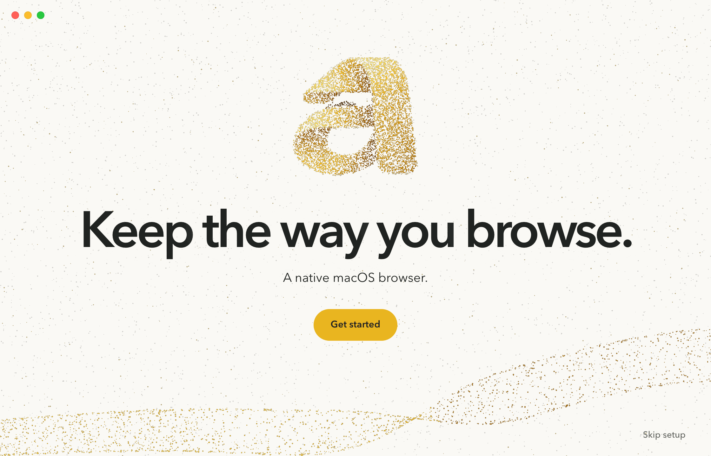
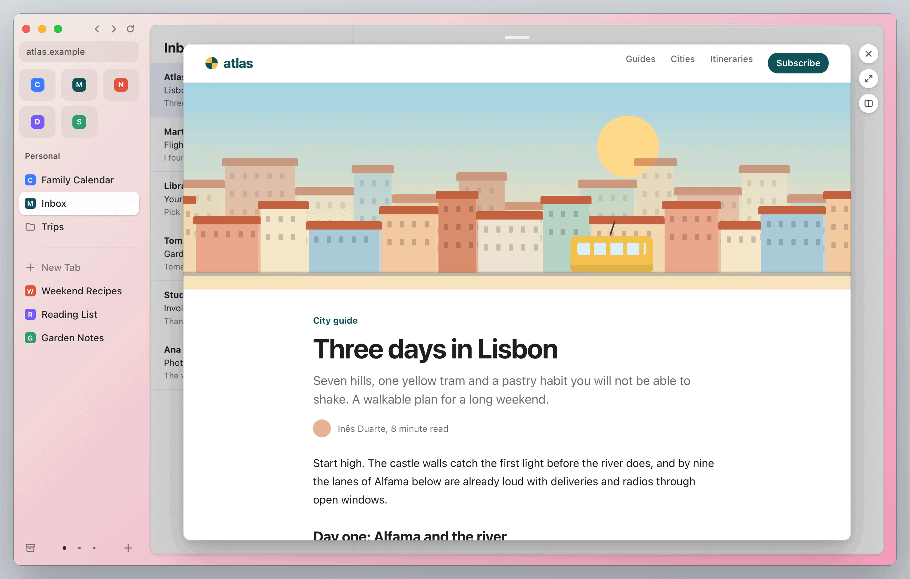
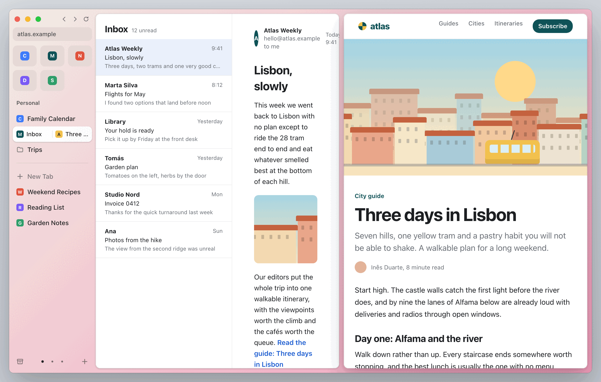
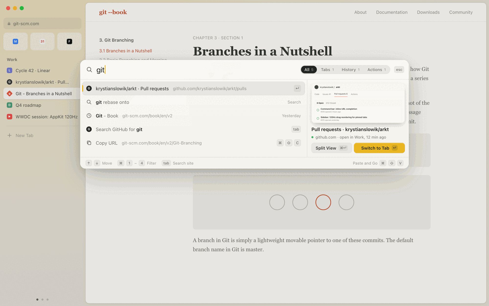
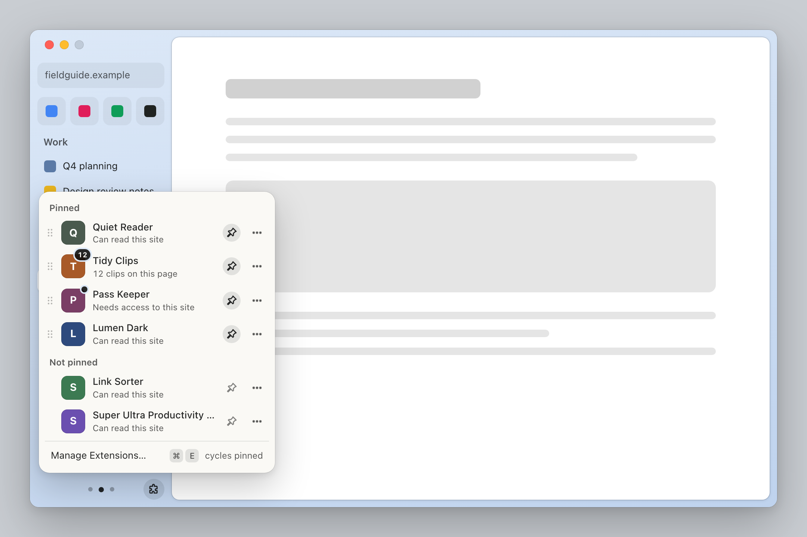

<p align="center">
  <picture>
    <source media="(prefers-color-scheme: dark)" srcset="design/onboarding/screens/01-welcome-dark.png">
    
  </picture>
</p>

<h1 align="center">arkt</h1>

<p align="center"><strong>Keep the way you browse.</strong></p>

<p align="center">
  A native macOS browser. A Swift and AppKit shell on a Chromium engine,<br>
  built for a 120 Hz native interface and Chrome extensions.
</p>

<p align="center">
  <a href="https://arkt.dev">arkt.dev</a> ·
  <a href="https://arkt.dev/#get">Join the waitlist</a> ·
  <a href="CONTRIBUTING.md">Contributing</a> ·
  <a href="https://buymeacoffee.com/krystianslowik">Buy me a coffee</a>
</p>

## Status

Arkt is in development. There is no download yet. A first release is in preparation.
[Join the waitlist](https://arkt.dev/#get) to hear when it is ready.

The screens below are captures of Arkt's approved designs. They show the intended look of each surface.

## What it is

Arkt keeps your tabs in a sidebar, organized into Spaces. The window chrome is native AppKit, with motion paced for
120 Hz displays. Pages run on Chromium, so sites render as they do in Chrome, and Chrome extension support is landing step by step.

## A first run worth seeing

The first run is one particle field that changes shape at every step. Arkt counts what it found in your browser data
and offers to bring it across, then lets you pick a look for your first Space.

<p align="center">
  <picture>
    <source media="(prefers-color-scheme: dark)" srcset="design/onboarding/screens/03-import-dark.png">
    
  </picture>
</p>

## Features

- **Spaces and the sidebar.** Spaces, Favorites, pinned tabs and folders, with Today tabs that archive themselves.
- **Peek.** Open a link over the page you are on, then close it or keep it.
- **Split View.** Two to four tabs side by side in one window.
- **Command bar.** One bar for addresses, searches, open tabs, history and actions.
- **Extensions.** Pin the extensions you use; the rest stay one click away.
- **Little Arkt.** Links from other apps open in a small window, so your main window stays where it was.
- **Import.** Bring Spaces, pinned tabs, folders and Favorites across from your browser data.

<table>
  <tr>
    <th>Peek</th>
    <th>Split View</th>
  </tr>
  <tr>
    <td width="50%">
      <picture>
        <source media="(prefers-color-scheme: dark)" srcset="design/peek/screens/peek-open-dark.png">
        
      </picture>
    </td>
    <td width="50%">
      <picture>
        <source media="(prefers-color-scheme: dark)" srcset="design/peek/screens/peek-split-dark.png">
        
      </picture>
    </td>
  </tr>
  <tr>
    <th>Command bar</th>
    <th>Extensions</th>
  </tr>
  <tr>
    <td width="50%">
      <picture>
        <source media="(prefers-color-scheme: dark)" srcset="design/command-bar/screens/hybrid-tab-dark.png">
        
      </picture>
    </td>
    <td width="50%">
      <picture>
        <source media="(prefers-color-scheme: dark)" srcset="design/extensions/screens/extensions-c-pinned-dark.png">
        
      </picture>
    </td>
  </tr>
</table>

## Build from source

The default Debug build is a development shell. It uses a WKWebView-backed engine, so it does not need a Chromium
checkout and does not show Chromium or extension support. The `Engine` configuration runs the shell on Arkt's
Chromium framework; see the [engine guide](engine/README.md) for that build.

You need macOS 15 or later, Xcode with Swift 6.2 or later, and [XcodeGen](https://github.com/yonaskolb/XcodeGen).
CI pins the versions in [`swift-tests.yml`](.github/workflows/swift-tests.yml).

From the repository root:

```zsh
(
  cd app/ArktShell &&
  xcodegen generate &&
  xcodebuild -project ArktShell.xcodeproj -scheme ArktShell -configuration Debug -derivedDataPath build build &&
  open build/Build/Products/Debug/ArktShell.app
)
```

Run the core and non-GUI shell tests:

```zsh
(cd app/ArktCore && swift test)
(cd app/ArktShell/ShellKit && swift test --skip ShellKitGUITests)
```

[CONTRIBUTING.md](CONTRIBUTING.md#before-opening-a-pull-request) has the full checks, GUI tests and the capacity rules
for machines that also build Chromium.

## Repository

| Path | What it is |
|---|---|
| [app/ArktCore](app/ArktCore) | Sidebar model, import, persistence, archive and auto-archive |
| [app/ArktShell](app/ArktShell) | AppKit app, XcodeGen project and the `ShellKit` UI package |
| [engine](engine/README.md) | Chromium overlay, upstream patches and the engine build |
| [design](design) | Approved designs, prototypes and screens for each surface |
| [docs/plans](docs/plans) | Design, implementation plans and results |
| [design/brand](design/brand/README.md) | Brand guide, artwork and social graphics |

## Contributing

Pick an unassigned [ready issue](https://github.com/krystianslowik/arkt/issues?q=is%3Aissue%20is%3Aopen%20label%3Astatus%3Aready)
and read [CONTRIBUTING.md](CONTRIBUTING.md) before you claim it. The [roadmap](https://github.com/krystianslowik/arkt/issues/30)
sets the order of work. Bug reports and documentation fixes are welcome too.

If you want to help cover development time and build machines, you can [buy me a coffee](https://buymeacoffee.com/krystianslowik).

## License

The source code is licensed under [MIT](LICENSE). Chromium is licensed separately under its own terms. The Arkt
name, mark and wordmark follow the [brand usage policy](design/brand/README.md#license).
