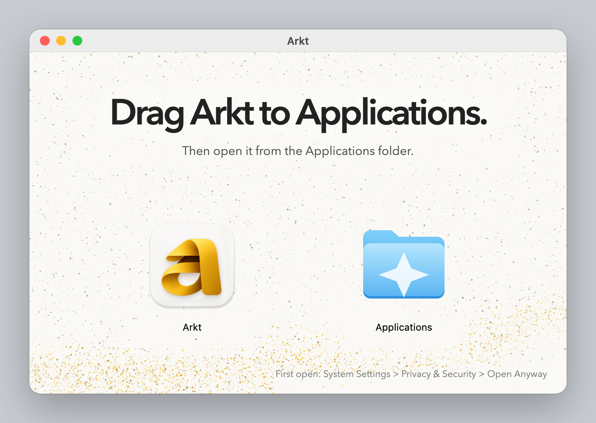
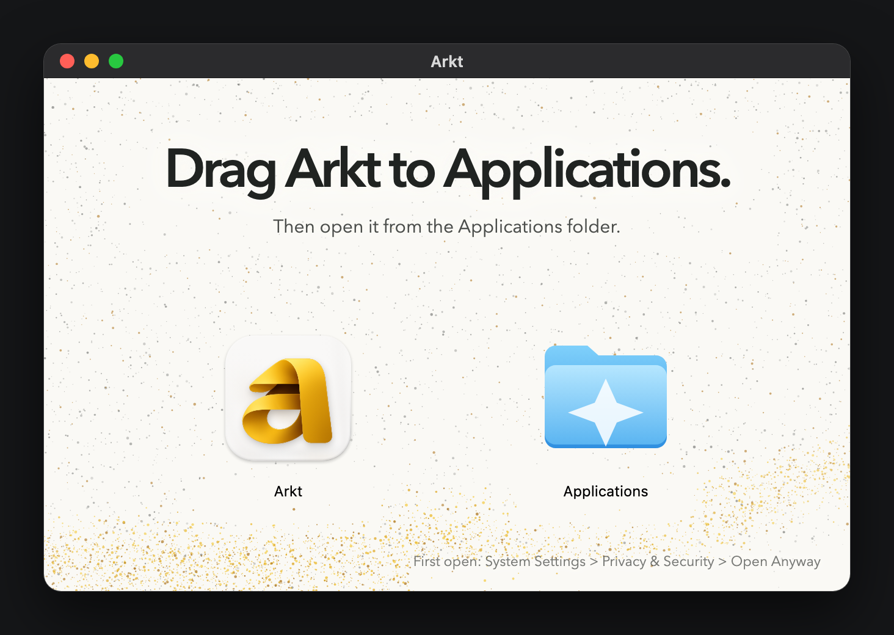

# Install DMG window

The Finder window that opens when a user mounts `Arkt-0.1.0-alpha.1-arm64.dmg` (issue #983). The maintainer picked
the Hero-line direction on the particle field (the earlier card, band and wordmark directions were rejected as not
fitting the Arkt designs; they remain in this branch's history).

## Gate

- **Surface:** a moment surface: hero style, Avenir Next, the Arkt particle language (sparse dust and the wave).
  Contents: a fixed background image, `Arkt.app`, an alias to `/Applications`, and the volume icon.
- **States:** Finder light and Finder dark; Retina and non-Retina (a multi-resolution TIFF built from the 1x and 2x
  backgrounds); one fixed window size, no scrolling, no toolbar, no status bar, no sidebar.
- **Primary action:** drag Arkt onto Applications. The line says so; there is no drawn arrow and no button.
- **Not shown:** empty, error and loading states do not exist for a mounted disk image.

## Spec

| Item | Value |
|---|---|
| Window content size | 660 x 420 pt (the title bar is extra) |
| View | icon view, icon size 128 pt, label text size 12 pt, no arrangement, toolbar and status bar hidden |
| Arkt.app icon center | (200, 262), points from the content top-left |
| Applications icon center | (460, 262) |
| Labels | Finder draws them about 76 pt below each icon center, in the system appearance |
| Headline | "Drag Arkt to Applications." Avenir Next DemiBold 44 pt, line height 46, tracking -0.055 em, centered, top 52 pt |
| Second line | "Then open it from the Applications folder." Avenir Next Regular 15 pt, centered, top 112 pt, 80% ink |
| Hint (edge text) | "First open: System Settings > Privacy & Security > Open Anyway", Avenir Next 11.5 pt, 55 to 60% ink, right 24 pt, bottom 16 pt |
| Volume name | `Arkt` |
| Volume icon | `.VolumeIcon.icns` is the app icon: build it from `design/brand/vector/macOS/mustard-on-white.svg` (the source of the `AppIcon` asset) and set the volume's custom-icon flag |

Text carries a soft halo in the field color instead of a card. Colors are porcelain `#FAF9F5` or graphite `#202321`
for the field and the text, with mustard only as motes (`#E9B520`, `#F3CA3D`, `#DCA319`, `#A96E12`). The hint is baked
into the image, so remove it once builds are notarized (#125). The text is rasterized from Avenir Next, which ships with
macOS; no font is bundled.

## Files

| Path | What it is |
|---|---|
| `background.png`, `background@2x.png` | The porcelain background, 660 x 420 and 1320 x 840 px, no icons. **This is what ships** (decision: porcelain) |
| `screens/install-light.png`, `screens/install-dark.png` | 2x renders of the Finder window mock (732 x 520 pt canvas): both on the shipped porcelain background: `install-light.png` with light Finder (black labels), `install-dark.png` with dark Finder chrome and dark labels |
| `prototype/index.html` | The background source (`#light` ships; `#dark` is an unused graphite reference); the static particle generator is `prototype/particles.js` |
| `prototype/mock.html` | The Finder window mock with a title bar, the real app icon and a stand-in Applications icon (Finder draws the real one) |

Renders: headless Chromium (Playwright's `chrome-headless-shell`), offline, `--force-device-scale-factor=2`,
`--window-size=732,520` for the mock and `660,420` for the background. The generator is seeded and static; it is a
simplified Canvas 2D version of the onboarding field (`design/onboarding/prototype/field.js`).

## Label readability (checked in a real Finder)

The shipped background is porcelain. Finder picks the icon label color from the background picture, not from the system
appearance: on a real mounted DMG in dark mode the labels stayed dark on the porcelain picture. So the labels are dark
in light and dark mode, and no glow or card is needed. `screens/install-dark.png` shows dark Finder chrome with dark
labels. Under each label the art keeps a calm zone: dust and wave motes thin out over about 24 pt around a 140 x 36 pt
area, so nothing competes with the text.

Path bar: if the user has Finder's path bar on (View > Show Path Bar, a per-user setting), it covers the bottom of the
window and hides the bottom-right first-open hint. The hint is edge text, so losing it there is acceptable; the release
notes carry the same instruction.
