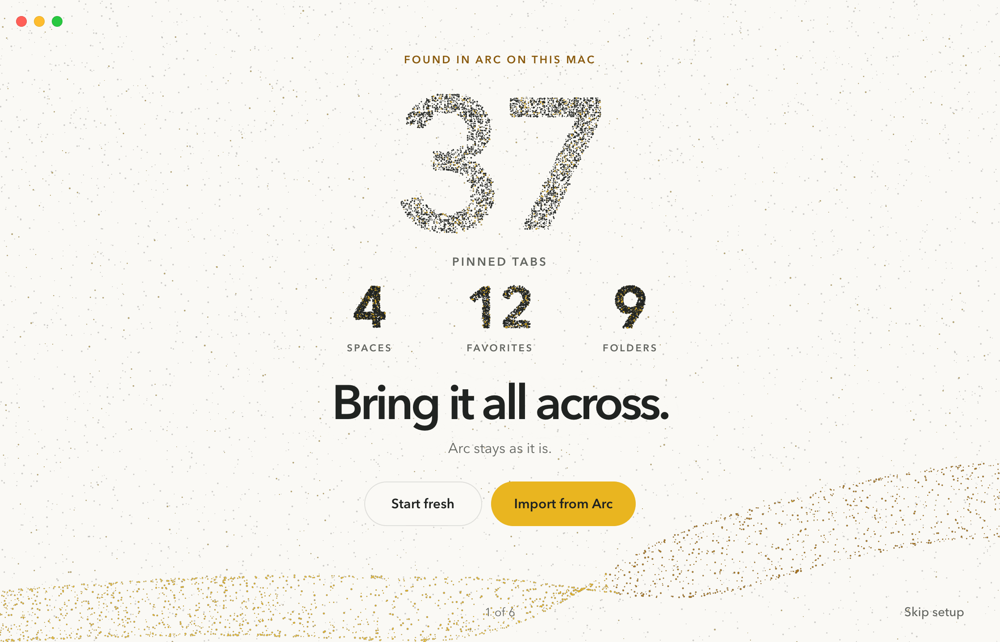

# Onboarding design

The first-run experience for issue #303, in the **Hero** direction: every step is the arkt.dev hero, with one
centred message over one particle field, Avenir Next at the website's scale and the website's pill buttons.

- Spec: [`docs/design/onboarding.md`](../../docs/design/onboarding.md). It wins over the prototype.
- Prototype: [`prototype/index.html`](prototype/index.html). It opens from disk or any static server; see spec
  section 17 for its parameters.
- Screens and keyframes: [`screens/`](screens/), light and dark at 2x, listed in spec section 16.

## How it got here

1. **Card wizard (rejected twice).** A centred card inside the browser window, system type at system sizes, small
   dialog buttons, progress dots and a boxed count table, with particles added behind it on the second round. The
   maintainer's verdict: too simple, generic, with the wrong font, sizes and buttons.
2. **Three directions from the website's language**, Welcome and Import only, in light and dark:
   - *Chapter*: every step as a website chapter, a large left column with the particle shape on the right and the
     glass capsule navbar after Welcome.
   - *Hero*: every step as the website's hero, centred, with the live count assembled from motes like the countdown.
   - *Acts*: the whole flow as one pinned section like the website's "The feel", the steps as large words down the
     left, that list doing the wayfinding.
3. **Hero was picked** for its Import screen with the large "37". The other two directions and the card wizard
   were removed; they remain in this branch's history.

## Language extraction

What makes arkt.dev feel premium, and what the first run now takes from it:

- **One typeface, set large and tight.** Avenir Next, DemiBold for headlines and Regular for copy. Headlines run
  54 to 80 pt here (72 to 132 px on the site), at a line height of 0.92 and tracked to -0.055 em. The scale jumps
  straight from a large headline to 18 to 20 pt copy.
- **The field is the stage.** One window-wide particle field; every step is a shape made from something real (the
  mark's pixels, the counts set in real type, the Space's own colours, the keys being taught). Text sits on the field
  with a soft halo instead of a card behind it.
- **Few, confident controls.** A 50 pt mustard pill and a glass pill. Back, progress and Skip setup are small text
  at the window's edge, the way the site's footer speaks.
- **Colour is three things.** Porcelain, graphite, and mustard only as a fill or a spark.
- **Short, plain copy.** One idea per screen, no instructions such as "Click", brand lines verbatim.
- **Choreographed motion.** Words resolve one by one, springs move everything that travels, and the one big moment
  per step is the field changing shape.

What made the card wizard feel generic: system UI type at 28 over 15 pt, a centred card inside the window with
particles behind it, 32 pt dialog buttons, step dots with Back and Next, a bordered count table, and two-sentence
paragraphs on every step.
