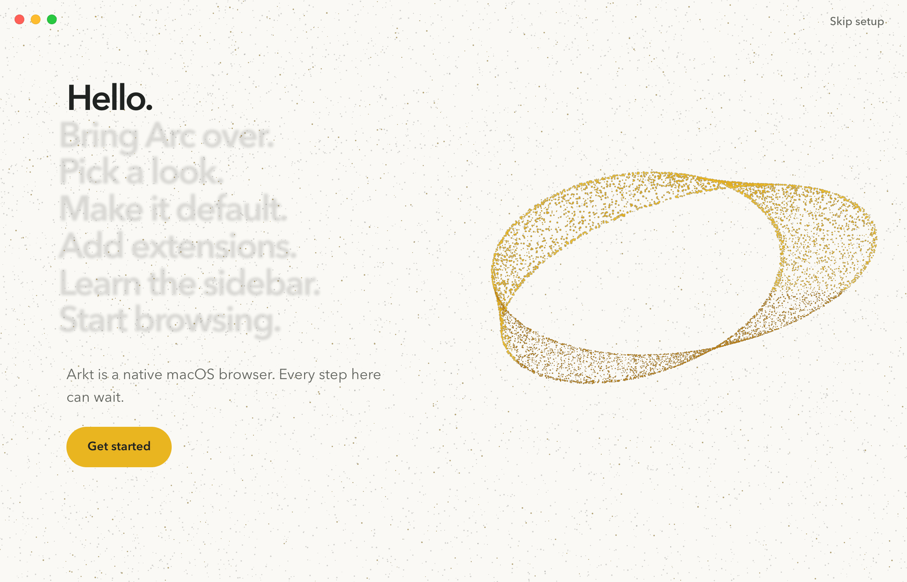
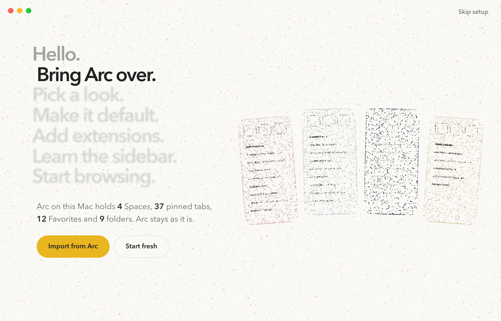

# Acts

 

The whole first run is one pinned chapter, built like "The feel" on arkt.dev, where Calm, Precise and Crafted are
large words and the current one is sharp while the rest wait soft. Here those words are the steps ("Hello.",
"Bring Arc over.", "Pick a look." and so on), set at 44 px down the left. The current step leans in by 10 px,
finished steps can be clicked to go back, and steps still to come stay faded and blurred. That list replaces
progress dots and the Back/Next bar entirely: you always see where you are and what is left. Under the list sits
one sentence and the step's buttons. On Import the live count is part of that sentence ("Arc on this Mac holds 4
Spaces, 37 pinned tabs..."). On the right, Welcome is the brand fold closed into a loop, and Import is Arc's four
Spaces as rooms in their own theme colours, each holding its pinned rows. It is the calmest of the three and the
most legible as a flow, and it carries the site's most distinctive interaction into the app. The trade is that the
step list takes the space a big headline would have.
