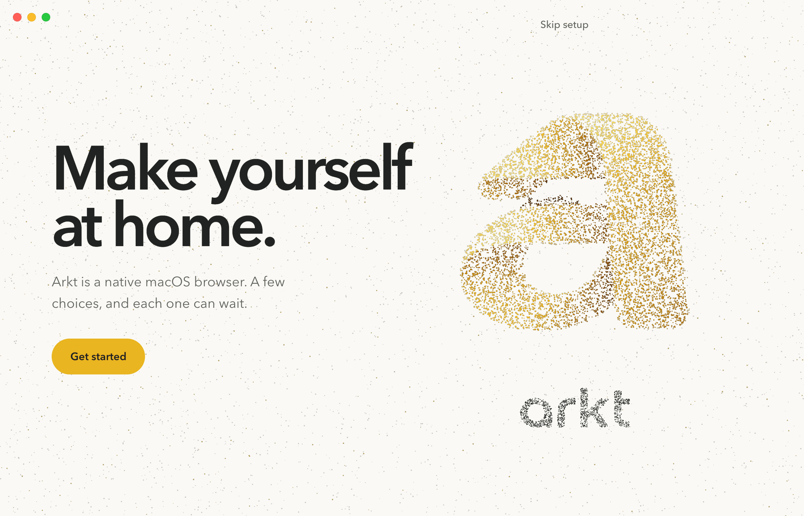
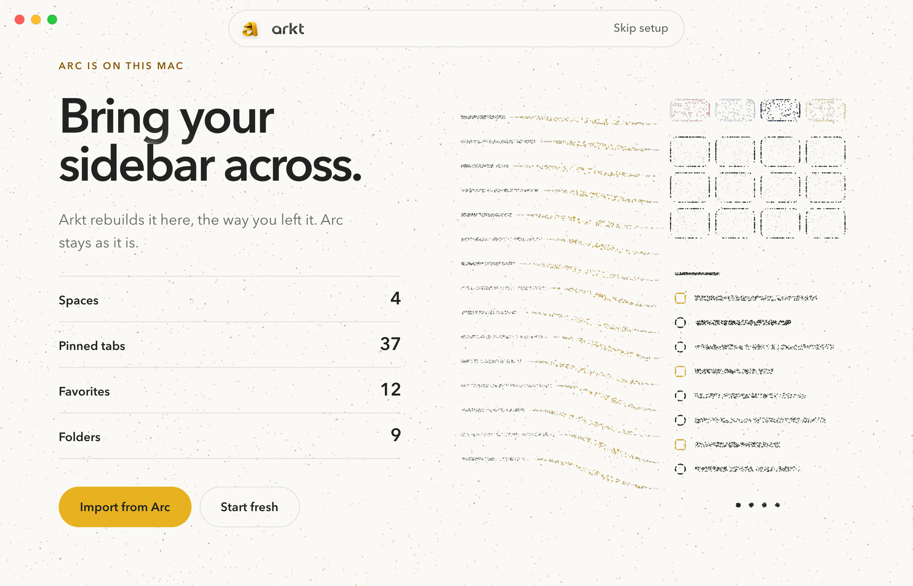

# Chapter

 

Every step is a chapter of arkt.dev. The copy holds a left column at the site's chapter scale (an 86 px headline on
Welcome and 60 px on the steps), and the particle formation owns the right half of the window. Welcome shows the
mark and the wordmark sampled from the approved artwork, the same pairing as "The feel". On "Get started" the mark
breaks apart and streams across, the site's glass capsule (wordmark, Skip setup) materializes at the top, and Arc's
sidebar data flows in mustard into a rebuilt sidebar drawn from the live counts: four Space swatches, twelve
Favorites, the pinned rows and four Space dots. The count itself is the site's hairline facts list, with each
number rising as Arkt reads Arc. It is the most familiar of the three for anyone who has scrolled the site, and the
easiest to extend, since every later step is one more chapter with its own formation. The cost is that it reads as
a page more than a moment.
