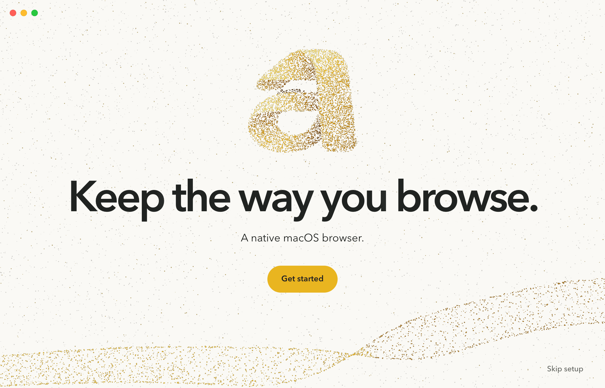
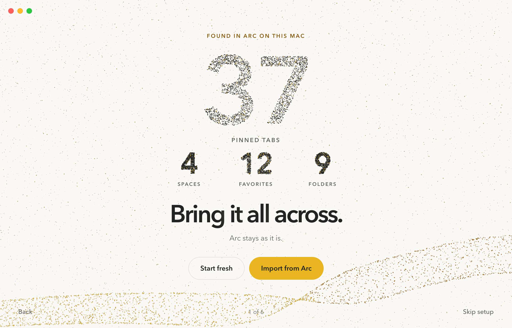

# Hero

 

Every step is the arkt.dev hero. One centred message sits over the field with the brand fold sweeping along the
bottom of the window, and the first words are the site's own: "Keep the way you browse." and "A native macOS
browser.", so the app opens on the promise people read before installing. On Import the mark dissolves into the
live count, built the way the site builds its countdown. Pinned tabs is the large number, Spaces, Favorites and
folders form the smaller row, and every digit re-forms from motes as the read-only pass finds more. The headline
and controls stay short and centred under it. Wayfinding is a quiet line at the bottom edge (Back, "1 of 6", Skip
setup), the way the site's footer speaks. It is the boldest and most cinematic of the three and the closest to the
site's first screen. Later steps need a shape that works as a centred sculpture, which suits the theme and tour
steps well.
