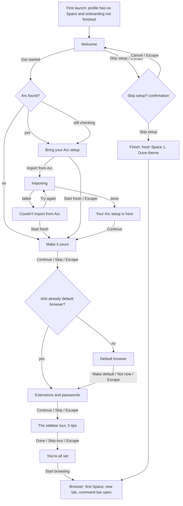
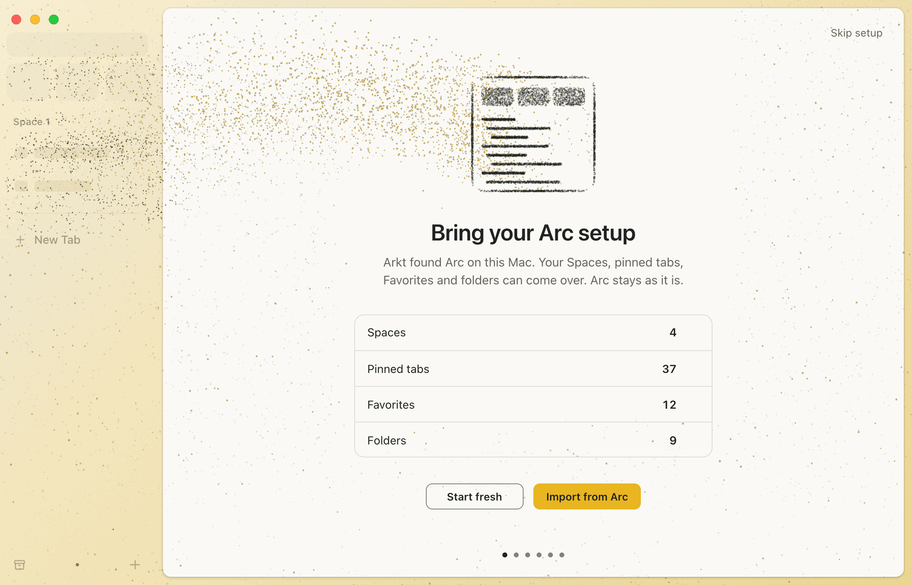
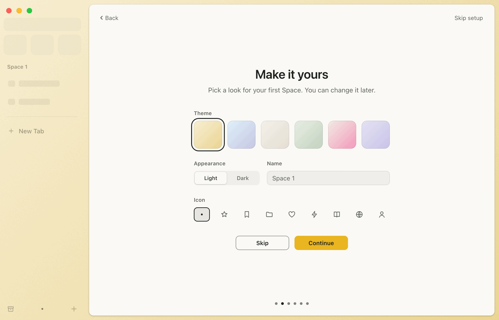
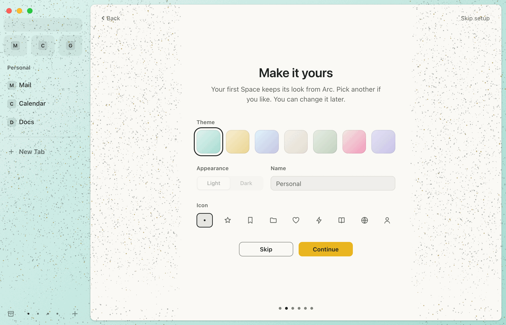
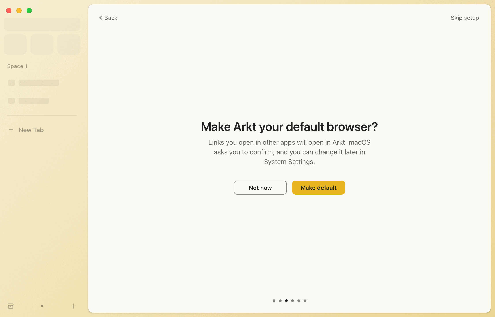
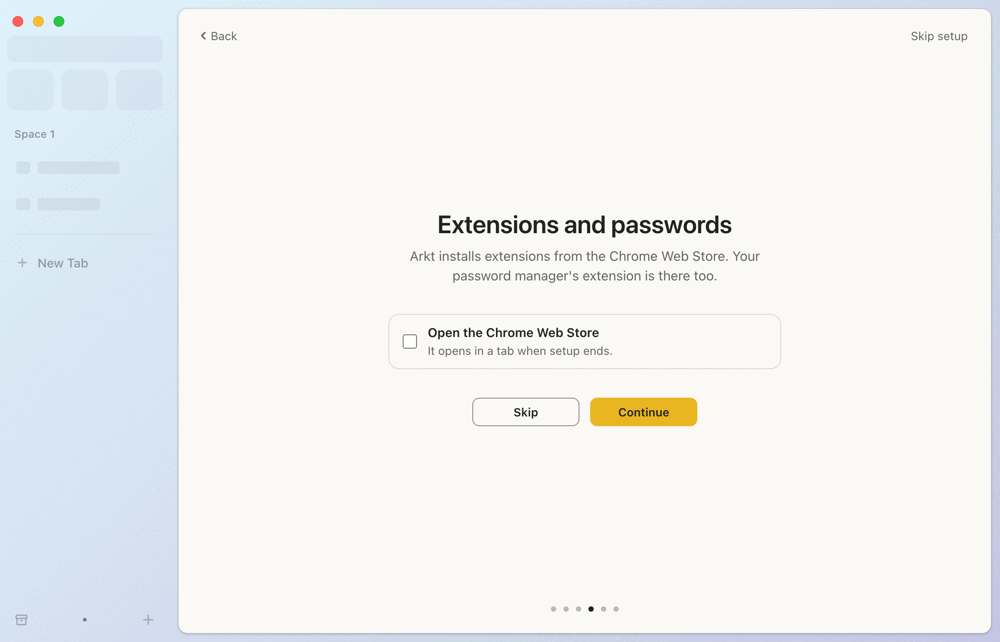
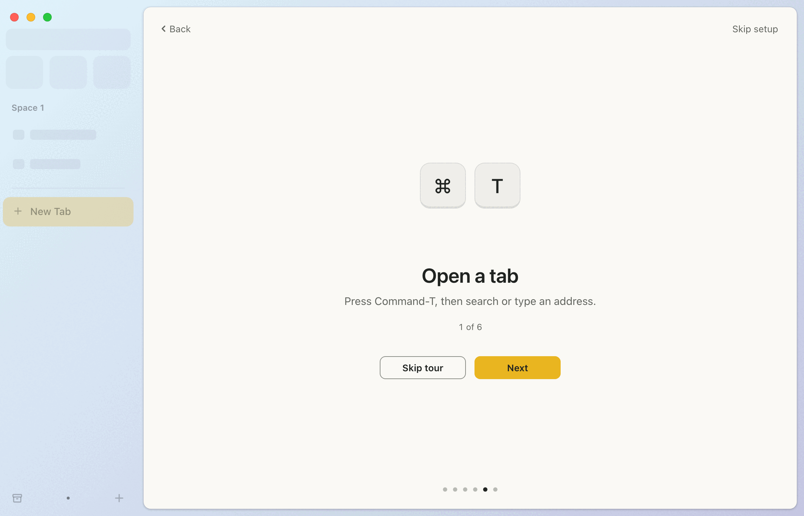
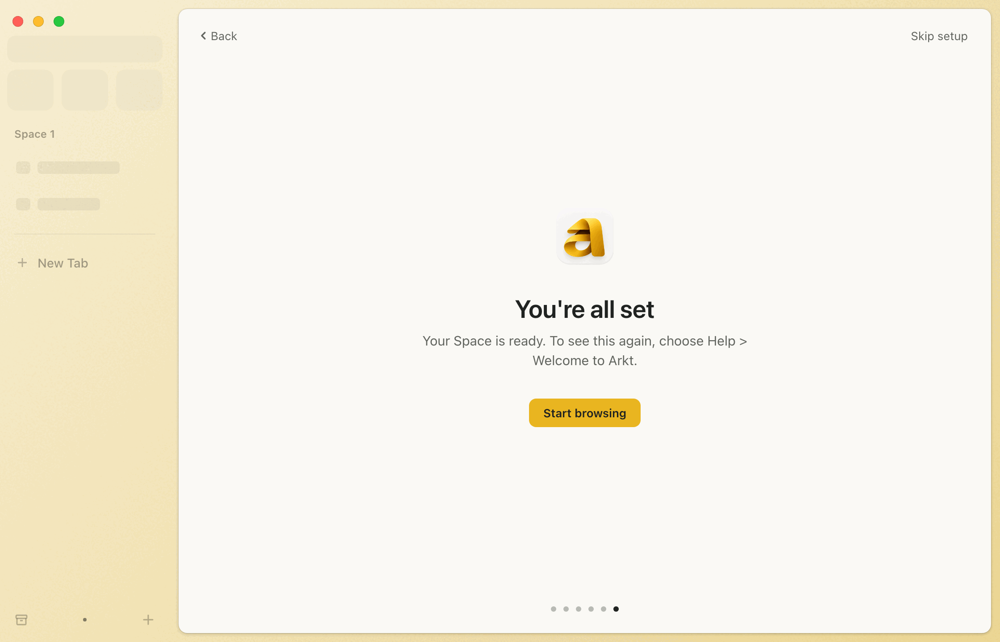
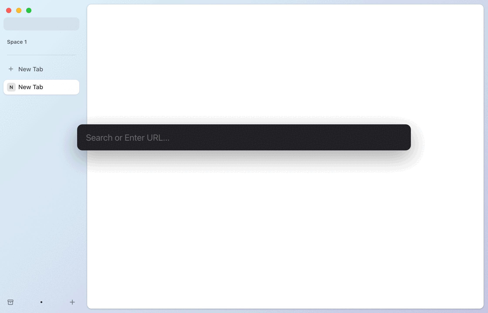
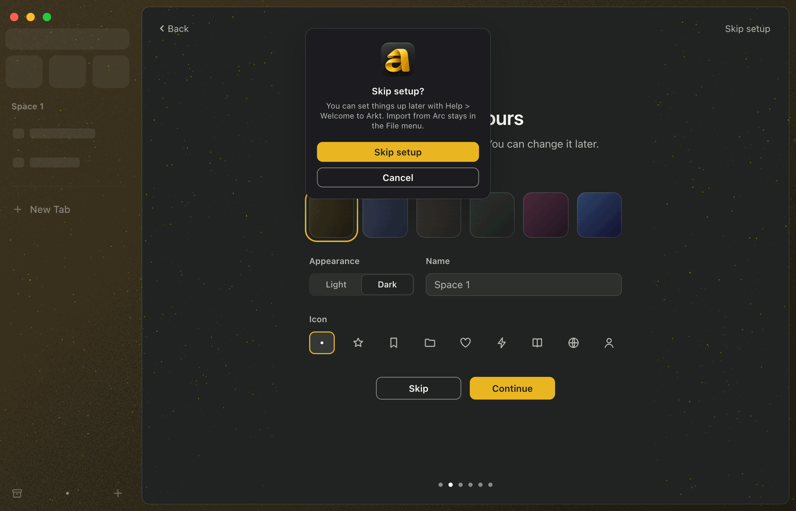

# Onboarding: first-run experience

Design for issue #303. This document is the spec for the native implementation; the clickable prototype at
[`design/onboarding/prototype.html`](../../design/onboarding/prototype.html) shows the same layout, copy and motion
for review. Where the two disagree, this document wins.

Status: design. Nothing here is implemented yet.

## Contents

- [Decisions (maintainer, 2026-10-25)](#decisions-maintainer-2026-10-25)
- [Particle field](#particle-field) (the hero of the flow; native Metal spec)
1. [Idea](#1-idea)
2. [Flow](#2-flow)
3. [Shared layout](#3-shared-layout)
4. [Tokens](#4-tokens)
5. [Steps](#5-steps)
6. [Motion](#6-motion)
7. [Keyboard](#7-keyboard)
8. [VoiceOver](#8-voiceover)
9. [Help > Welcome to Arkt](#9-help--welcome-to-arkt)
10. [State and persistence](#10-state-and-persistence)
11. [Parity with Arc](#11-parity-with-arc)
12. [Implementation dependencies](#12-implementation-dependencies)
13. [Open questions (resolved)](#13-open-questions-resolved)
14. [Screenshots](#14-screenshots)
15. [Prototype](#15-prototype)

## Decisions (maintainer, 2026-10-25)

Answers to the seven open questions of the first draft. The rest of this document already follows them.

| # | Question | Decision | Where it lands |
|---|---|---|---|
| 1 | Live count before import, or import then show? | **Live count before importing.** The read-only counting pass in `ArcImportCoordinator` is in scope of the implementation issue | Sections 5.2, 12 |
| 2 | Make it yours after an import? | **Yes, it also appears after an import**, for the first imported Space. It starts on the "From Arc" swatch (the imported Space's own look), selected; Skip keeps the selection the step opened with | Sections 2, 5.3 |
| 3 | Name 1Password in the extensions step? | **No.** The copy stays generic ("your password manager's extension") | Section 5.5 |
| 4 | Tour length | **Five tips.** Command-L is folded into the first tip | Section 5.6 |
| 5 | Default first-Space theme | **Dune**, the mustard-adjacent family. It is the first swatch and the theme behind the window from the fold on | Sections 3, 4, 5.3 |
| 6 | Should Skip setup confirm? | **Yes.** Skip setup (and Escape on Welcome) asks first | Section 5.9 |
| 7 | First-launch window size | **At least 1000 x 680 pt, fitting smaller screens**: on a smaller visible frame the window takes the visible frame and the compact layout applies | Section 3 |

### Revisions after design review (2026-10-25)

- Flow diagram: the tour has 5 tips.
- Import path theme step: a selected "From Arc" swatch replaces "no swatch selected"; Skip keeps the selection the
  step opened with (section 5.3).
- Escape in the Name field ends editing and restores the previous value; a second Escape skips (section 7).
- Right arrow only returns to steps visited before a Back; arrows inside controls never change the step (section 7).
- A confirmed Skip setup during or after an import adds no empty Space (section 2).
- Pressed states for the secondary button, Back and Skip setup; a disabled-button spec; a real pressed fill under
  Reduce Motion (sections 3, 6.2).
- Idle progress dots at full `brandControlBorder`, which is darkened to #80837C / #868A82 so it keeps 3:1 on the
  card and on the hover and pressed fills (sections 3, 4).

### Particle field (maintainer request, 2026-10-25)

The first version read as too simple. The brand particle field from arkt.dev is now the hero of every step: a cloud
gathers into the mark on Welcome, Arc data streams in mustard into the sidebar on Import, the field re-tints with the
chosen theme, each tour tip is drawn in particles, and the field folds onto the card as the first page appears. See
[Particle field](#particle-field). Everything decided and reviewed above stays as it is.

## 1. Idea

Onboarding happens inside the real browser window, not in a separate wizard window. The window is already there,
with the Space theme behind it and the sidebar in its normal place, and the setup runs in the content card where the
first page will later appear.

- **Welcome is a brand field.** The first launch fills the whole window with the brand surface (porcelain in light,
  graphite in dark), the mark, the wordmark and the descriptor.
- **The field folds into the window.** On "Get started" the field contracts to the content card's exact frame and
  corner radius while the sidebar fades in around it. The brand surface becomes the card, and the card hosts the
  setup steps. This is the one bold moment: it shows where everything lives before the user has read a word.
- **The window fills in as you answer.** The sidebar is quiet (ghost rows) during setup. Importing from Arc fills it
  with the imported rows; choosing a theme repaints the window behind the card live; naming the Space and picking an
  icon update the sidebar title and the dock as you type.
- **Done is the browser.** The last step does not close a window. The card turns into the first tab's page and the
  command bar opens, ready for an address.

- **The particle field carries it all.** One field of about twenty thousand motes lives between the card surface and
  its content. Every step is a shape made of it, built from real things (the mark's own pixels, the Arc sidebar's
  data, the theme's gradient, the keys and gestures being taught), and the motes keep moving inside each shape. It is
  the same system as the website's, so the app's first minute looks like the brand people saw before installing.

Everything else stays quiet: one centered column, system type, the brand's porcelain and graphite, mustard only on the
primary button. Motion is reserved for moments that explain something (the fold, the step direction, the import
filling the sidebar, the tour demos).

## 2. Flow



Branch rules:

| Condition | Effect |
|---|---|
| Arc found (Arc's sidebar file exists, `AppSession.refreshArcImportAvailability`) | Import step is shown |
| Arc not found | Import step is left out; Make it yours is the first step; one fewer progress dot |
| Arc check still running when Welcome is left | Import step is shown in its counting state; if the check then says "no Arc", the step is replaced by Make it yours with a normal forward transition |
| Import path chosen | Make it yours is shown for the first imported Space. It starts on a selected "From Arc" swatch (the imported Space's own look), the name field shows the imported name as its placeholder, and Skip keeps the Arc look |
| Start fresh, or import failed and then Start fresh | Make it yours is shown, starting on Dune |
| Arkt is already the default browser | Default browser step is left out |
| "Skip setup" (any step) or Escape on Welcome | Asks first (section 5.9). On confirm: if no import ran, a fresh "Space 1" with Dune, then the browser state. If an import finished, no Space is added: the browser opens on the first imported Space. If an import is running, no Space is added either: the import finishes, then the browser opens on the first imported Space, or on a fresh "Space 1" if the import fails. On Cancel: back to the same step, nothing changed |

Every step can be skipped: each has a secondary action (Skip, Not now, Start fresh, Skip tour), Escape runs that
secondary action, and "Skip setup" in the card's top-right corner ends the whole flow from any step after a
confirmation. An import in progress is the only thing Escape does not interrupt. A confirmed Skip setup during an
import creates no Space: the window shows the browser state with the quiet sidebar, the import finishes, then the
browser opens on the first imported Space (or on a fresh "Space 1" if the import fails) and the File > Import from Arc
summary alert appears.

Progress dots count the steps after Welcome for the current branch: Arc found is 6 (import, theme, default,
extensions, tour, done) on both the import and the fresh path; no Arc is 5; Arkt already default removes one more.

## 3. Shared layout

All sizes in points on the existing grid (`ShellMetrics`, `SidebarMetrics`, brand spacing 8, 16, 24, 32, 48, 64, 96).
Reference window for every screenshot: 1120 x 720 pt.

```
+--------------------------------------------------------------------------------------+
| o o o                                                                                |
| [ URL bar (ghost)   ]  +----------------------------------------------------------+  |
| [fav][fav][fav]        | < Back                                     Skip setup     |  |
| Space 1                |                                                          |  |
| [== ghost row ==  ]    |                   [ illustration 440x152 ]  (tour only)  |  |
| [== ghost row     ]    |                        Title 28/34                       |  |
| ----------------       |              Body 15/22, max 400 wide, centered          |  |
| + New Tab              |               [ step controls, 440 wide ]                |  |
|                        |               [ Secondary ]  [ Primary ]                 |  |
|                        |                                                          |  |
| [arch]   .   [+]       |                        o o * o o o                       |  |
|  sidebar 190           +----------------------------------------------------------+  |
+--------------------------------------------------------------------------------------+
```

| Element | Spec |
|---|---|
| Window | First run opens at least 1000 x 680 pt so the tallest step (Make it yours) fits without scrolling. When the screen's visible frame is smaller, the window takes the visible frame and the compact layout applies |
| Compact layout | When the card is 620 pt tall or less: column padding 48 top and 56 bottom, controls and button row 24 below what precedes them, 16 between Make it yours groups, tour illustration 120 high (mini window scaled to 0.79, key caps 52), Done mark 24 above the title. Nothing else changes |
| Background | The Space theme (`ThemeBackgroundView`: gradient plus grain): Dune, the default first-Space theme, until the user picks one or an import brings the first Space's Arc look |
| Sidebar | Normal position and width (190, `ShellMetrics.sidebarDefaultWidth`), Toolbar-off layout (URL bar at y 40, height 30). Non-interactive and hidden from accessibility during setup |
| Ghost sidebar | Real geometry with placeholder content: URL bar, three empty Favorite tiles, the Space title, two skeleton rows (16 pt icon block, text block 70-92 pt wide, `sidebarItemHovered` fill, radius 4), divider, "New Tab" row, dock with one dot. Content at opacity 0.55 |
| Content card | Normal card frame (insets 10, radius 10, `cardBorder`, `cardShadow`), filled with `BrandTokens.surfaceBrand` instead of the page |
| Column | 440 wide, centered horizontally and vertically in the card; padding 64 top, 32 sides, 72 bottom (keeps clear of the dots) |
| Title | SF Pro Display Semibold 28/34, tracking -0.3 pt, `brandTextPrimary`, balanced wrapping, centered |
| Body | SF Pro Text Regular 15/22, `brandTextSecondary`, max 400 wide, 8 below the title |
| Controls block | 32 below the body |
| Button row | 32 below the controls (or the body), centered, 12 between buttons (same gap as `EmptyStateView`) |
| Primary button | Height 32, min width 120, padding 16, radius 8, SF Pro Text Semibold 13. Fill `accent`, hover `accentHighlight`, pressed `accentPressed`, label `onAccent`. It is the default button (Return) |
| Secondary button | Same size, no fill, 1 pt inside border `brandControlBorder`, label `brandTextPrimary`; hover fill `brandControlFill`, pressed fill `brandControlFillPressed` plus the press scale. The border keeps 3:1 on both fills (section 4) |
| Back | Top-left of the card at (16, 16), height 28, chevron 12 plus "Back", 13 pt, `brandTextSecondary`; hover fill `brandControlFill` and text `brandTextPrimary`, pressed fill `brandControlFillPressed`; hidden on the first step after Welcome and on Done |
| Skip setup | Top-right of the card at 16, height 28, 13 pt, `brandTextSecondary`; hover fill `brandControlFill` and text `brandTextPrimary`, pressed fill `brandControlFillPressed` |
| Disabled buttons | "Import from Arc" while counting, "Importing...", and Start fresh while importing: label and fill at 40 % opacity, no hover, no press scale, not the default button |
| Progress dots | 6 pt dots, 14 pt pitch, centered, 24 above the card bottom; idle dots in `brandControlBorder` at full opacity (3.65:1 light, 4.51:1 dark against `surfaceBrand`, WCAG 1.4.11); the current one is a separate 6 pt dot in `brandTextPrimary` that moves |
| Focus ring | 2 pt `BrandTokens.focusRing`, 2 pt outside the control (graphite in light, mustard in dark) |

Typography is San Francisco throughout. This is a deliberate choice: Arkt is a native macOS app, the brand guide
uses the system stack, and the onboarding should read as part of the system, with the wordmark artwork carrying the
brand voice. No other typeface is introduced.

Light and dark follow the system appearance for everything in the card and the Welcome field. The sidebar chrome
follows the Space theme's `isDark`, exactly as it does in the browser (it uses `ShellTokens`, not `BrandTokens`).

## 4. Tokens

### Existing tokens used

| Token | Light | Dark | Used for |
|---|---|---|---|
| `BrandTokens.surfaceBrand` | porcelain #FAF9F5 | graphite #202321 | Welcome field, card during setup |
| `BrandTokens.accent` | mustard #E9B520 | mustard | Primary button fill, tour highlight (as a 20-28 % fill) |
| `BrandTokens.accentHighlight` | #F3CA3D | #F3CA3D | Primary button hover |
| `BrandTokens.accentPressed` | #DCA319 | #DCA319 | Primary button pressed |
| `BrandTokens.onAccent` | graphite | graphite | Primary button label (8.38:1 on mustard, 7.02:1 on pressed) |
| `BrandTokens.focusRing` | graphite | mustard | Focus rings, selected swatch ring, selected icon ring |
| `BrandTokens.accentText` | #8A5A0E | mustard | Not needed in the current copy; reserved for an accent-colored link |
| `ShellTokens.*` | | | Sidebar, card border and shadow, command bar, page surface (`toolbarSurface`) |

Mustard is never text on porcelain and never a ring on porcelain, as the brand rules require.

### Proposed `BrandTokens` additions

The brand kit has no secondary text or border colors yet. Text and hairline values come from
`design/brand/brand-guide.html`; the control border was darkened from the first draft (#8C8F88 / #6E726B) so it keeps
3:1 on the hover and pressed fills. Contrast is WCAG 2.x against `surfaceBrand` unless stated.

| Proposed token | Light | Dark | Contrast | Use |
|---|---|---|---|---|
| `brandTextPrimary` | #202321 | #FAF9F5 | 15.06:1 | Titles, button labels, counts |
| `brandTextSecondary` | #62655F | #B6BAB3 | 5.62:1 / 8.06:1 | Body, labels, notes, Back, Skip setup |
| `brandHairline` | #DEDED5 | white 10 % | decorative | Count list border and dividers, option rows |
| `brandControlBorder` | #80837C | #868A82 | 3.65:1 / 4.51:1; on the hover fill 3.32 / 3.79; on the pressed fill 3.02 / 3.13 | Secondary button border, idle dots (WCAG 1.4.11 non-text 3:1 in every state) |
| `brandControlFill` | graphite 5 % | porcelain 6 % | n/a | Hover fill, text field fill, segmented control track, key caps |
| `brandControlFillPressed` | graphite 10 % | porcelain 12 % | n/a | Pressed fill of secondary buttons, Back and Skip setup (also the only press feedback under Reduce Motion) |

`BrandTokensTests` should cover the contrast pairs above, including the border on the hover and pressed fills.

### Proposed first-Space themes

`SpaceThemeCatalog` has only Paper and Dusk, both marked `TODO(design)`. The theme step needs a small set with a light
and a dark variant per family. Two-stop gradients, top-left to bottom-right, no texture (so they round-trip through
the bridge, as the catalog comment requires). Mist reuses the stub "Work" light stops and Dusk; Blossom reuses the
stub "Personal" stops; Indigo dark reuses the stub "Dev" stops; Paper light is the existing Paper.

| Family | Light stops | Dark stops |
|---|---|---|
| Dune (default, first swatch) | #F7EED2 to #EBD592 | #3D3420 to #1E1A10 |
| Mist | #E0F2FB to #C5C6E2 | #3A4158 to #1C2030 |
| Paper | #F4F1EA to #E4DDD2 | #3A3631 to #211F1C |
| Sage | #E6EDE3 to #C4D3C0 | #2F3B33 to #171E1A |
| Blossom | #F2EAE4 to #F29BBB | #4A2A3A to #1F1520 |
| Indigo | #E4E2F4 to #C9C3E8 | #2D4468 to #120F2E |

Each new stop pair has to pass the existing `ShellTokensContrastTests` (sidebar text and icons over every shipped
theme) before it ships; adjust a stop rather than the chrome tokens if one fails.

## 5. Steps

Copy below is final unless an open question says otherwise. Sentence case everywhere; "Arkt" capitalized in
sentences, the lowercase name only as the wordmark artwork.

### 5.1 Welcome


| | |
|---|---|
| Surface | Full-window `surfaceBrand` field above the sidebar and card, with grain at about half the theme grain opacity. Traffic lights stay visible above it |
| Mark | A 112 x 112 pt frame, centered (clear space well above a quarter of the icon). The mark appears only as particles sampled from `01-mustard-on-white.png` (formation `mark`). Without the particle layer it is the raster PNG (`01` light, `02` dark), scaled proportionally, no shadow or effect. The frame keeps the accessibility label "Arkt" either way |
| Wordmark | `wordmark-graphite.png` in light, `wordmark-ivory.png` in dark, 90 x 38 pt (the 180 x 76 px source at 2x), 32 below the mark |
| Descriptor | "A native macOS browser." SF Pro Display Regular 17/22, `brandTextSecondary`, 16 below the wordmark |
| Primary | "Get started", 48 below the descriptor |
| Corner | "Skip setup" at the field's top-right (16, 16) |
| Accessibility title | "Welcome to Arkt" (not drawn; the wordmark is decorative) |

The group's block is vertically centered; the mark sits slightly above the window's center.

### 5.2 Bring your Arc setup



States: counting, ready, importing, imported, failed.

| State | Title | Body | Controls | Buttons |
|---|---|---|---|---|
| Counting | Bring your Arc setup | Arkt found Arc on this Mac. Your Spaces, pinned tabs, Favorites and folders can come over. Arc stays as it is. | Count list, numbers show "-" | Start fresh, Import from Arc (disabled) |
| Ready | same | same | Count list with numbers | Start fresh, **Import from Arc** |
| Importing | same | same | Each row gets a 14 pt spinner, replaced by a check as its category finishes | Start fresh (disabled), Importing... (disabled) |
| Imported | Your Arc setup is here | {n} Spaces, {n} pinned tabs, {n} Favorites and {n} folders came over. | Count list, all checked; note "{n} items couldn't be imported." only when `skipped` > 0 | **Continue** |
| Failed | Couldn't import from Arc | Arkt couldn't read Arc's data. Try again, or import later from File > Import from Arc. | none | Start fresh, **Try again** |

Count list: 440 wide, radius 12, 1 pt `brandHairline` border, four rows of 44 (Spaces, Pinned tabs, Favorites,
Folders), 16 side padding, name 14 regular `brandTextPrimary`, count 14 semibold with tabular figures, a 16 pt state
slot 12 to the right of the count. Counts only: no Space names, titles, URLs or paths, matching the import summary's
counts-only rule. Plural rules apply to every count ("1 Space", "1 pinned tab", "1 folder"); a category with 0 is
still listed.

"Arc stays as it is" is true: the importer only reads Arc's folder.

While the import runs and when it finishes, the ghost sidebar fills with the imported content of the first Space
(Favorites, its title, pinned rows) and the dock shows one dot per imported Space.

The first-run path does not show the `NSAlert` summary that File > Import from Arc shows; the Imported state replaces
it. File > Import from Arc keeps the alert.

### 5.3 Make it yours



| | |
|---|---|
| Title | Make it yours |
| Body | Fresh path: "Pick a look for your first Space. You can change it later." Import path: "Your first Space keeps its look from Arc. Pick another if you like. You can change it later." |
| Theme | Label "Theme" (12 semibold, `brandTextSecondary`, 8 above). Six swatches in a row on the fresh path (about 63 pt square); seven on the import path, the first being "From Arc" (about 52 pt square); 440 wide, 12 apart, radius 12, a 1 pt inner hairline. Selected: a 2 pt `focusRing` ring 4 pt outside the swatch. Radio group |
| Appearance | Label "Appearance". Segmented control "Light" / "Dark", track `brandControlFill` radius 8 with 2 pt padding, segments 72 x 28, the thumb is a `surfaceBrand` pill with a hairline. Starts at the system appearance |
| Name | Label "Name", text field 32 high, radius 8, `brandControlFill`, 1 pt `brandHairline`, 14 pt text, placeholder "Space 1" (the name New Space would give, `SpaceNaming`), 40 characters max. Fills the rest of the row, 16 from the segmented control |
| Icon | Label "Icon". Nine choices from `SpaceIconCatalog` (None, Star, Bookmark, Folder, Heart, Bolt, Book, Globe, Person) as SF Symbols at 18 pt in 36 x 32 buttons spread over 440. Selected: `brandControlFill` plus a 1.5 pt inner `focusRing` ring |
| Group spacing | 24 between Theme, the Appearance/Name row and Icon |
| Buttons | Skip, **Continue** |

Live preview: choosing a swatch or the appearance repaints the window background behind the card at once
(`ThemeBackgroundView.replaceThemes(_:crossfade:)`), and the sidebar chrome flips between its light and dark token
sets with it. Typing a name updates the sidebar's Space title; picking an icon replaces the dock dot with the symbol.
Fresh path: Dune is selected at the start. Import path: a first swatch labeled "From Arc" (VoiceOver "From Arc")
draws the first imported Space's own gradient and is selected at the start, so keyboard focus and VoiceOver land on
it and the user can always return to the Arc look; the name placeholder is that Space's name. While "From Arc" is
selected the Appearance control is disabled (40 %) and shows the Arc theme's own light or dark; it applies to the six
families. Skip keeps the selection, name and icon the step opened with and drops any preview; Continue keeps the
current choices. Both paths behave the same way.



The Space itself is created (fresh path) or updated (import path) when this step is left, so Back from the next step
returns to the same choices.

### 5.4 Default browser



| | |
|---|---|
| Title | Make Arkt your default browser? |
| Body | Links you open in other apps will open in Arkt. macOS asks you to confirm, and you can change it later in System Settings. |
| Buttons | Not now, **Make default** |

Not pushy: one question, no illustration, "Not now" is a full button next to the primary, no follow-up nag. After
"Make default" the system confirmation appears; whatever the answer, the flow moves on when the system prompt closes.
The body line while the prompt is up: "macOS is asking you to confirm. Arkt continues either way." The step is left
out when Arkt is already the default browser.

### 5.5 Extensions and passwords



| | |
|---|---|
| Title | Extensions and passwords |
| Body | Arkt installs extensions from the Chrome Web Store. Your password manager's extension is there too. |
| Option | Checkbox row, 440 wide, radius 12, hairline border, 12 x 16 padding: **Open the Chrome Web Store** / "It opens in a tab when setup ends." Off by default |
| Buttons | Skip, **Continue** |

No password manager is named (decision 3). Nothing opens mid-setup. When the option is on, the Web Store opens as the first Space's tab at the end instead of the
empty new tab. Desktop-app integration for password managers depends on signing (#23), and the copy only claims
what the engine build already does (Web Store install works on the native window, engine week 3 results, W7). This
step is shown only in builds that run the Chromium engine; the WKWebView development shell leaves it out.

### 5.6 The sidebar tour



Five tips, one at a time (decision 4). Each has an illustration area (440 x 152), a title, a body, "{n} of 5" (12 pt
`brandTextSecondary`, tabular, 16 below the body), and Skip tour, **Next** ("Done" on the last tip). Back steps
through tips before leaving the tour. A matching area of the ghost sidebar is highlighted with a mustard fill
(`accent` at 28 % over light themes, 20 % over dark, radius 10) so the tip points at the real place.

| # | Title | Body | Illustration | Sidebar highlight | Parity rows |
|---|---|---|---|---|---|
| 1 | Open a tab | Press Command-T to search or type an address. Command-L edits the address of the current tab. | Two key-cap pairs, "Command" "T" and "Command" "L", 32 apart | New Tab row and URL bar | KB-001, KB-002 |
| 2 | Close by archiving | Command-W closes a tab and keeps it in the Archive, so you can find it again. | Key caps "Command" "W" | Archive button in the dock | KB-008 |
| 3 | Switch Spaces | Swipe left or right with two fingers on the sidebar to move between Spaces. | Mini window: two finger dots swipe, the sidebar pages over, the page dot moves | Dock dots | GS-001, BH-035 |
| 4 | Split the view | Drag a tab from the sidebar onto the page to see two tabs side by side. | Mini window: a tab chip travels from the sidebar to the page, a drop zone shows, the page splits | Pinned rows | GS-011, BH-117 |
| 5 | Keep Favorites close | Drag a tab to the top of the sidebar to make it a Favorite. | Mini window: a tab chip travels up into the Favorites row | Favorites | GS-008, BH-047 |

With the particle layer, each tip's illustration is its particle formation (`tour1` to `tour5`, see
[Particle field](#particle-field)); the key caps and mini-window demos below are the fallback without it.

Key caps: 64 high, min 64 wide, radius 14, SF Pro Display Medium 28, `brandControlFill` with a hairline border and a
3 pt hairline bottom edge. Key glyphs are the Command symbol and the letter, drawn as text, not images. Mini window:
280 x 152, radius 12, a 72 wide sidebar strip and a page inset 4; the moving chip is an `accent` fill.

Tip 2 copy assumes Today tabs archive on close, which is the shipped behavior (KB-008); a pinned tab closes and stays
pinned, which the tip does not need to explain.

### 5.7 You're all set



| | |
|---|---|
| Mark | A 64 pt mark frame, 32 above the title, drawn as particles (formation `doneMark`); the PNG icon without the particle layer |
| Title | You're all set |
| Body | Your Space is ready. To see this again, choose Help > Welcome to Arkt. |
| Buttons | **Start browsing** |

### 5.8 Landing in the browser



"Start browsing" (or Skip setup) ends the flow: the sidebar becomes live (no ghost, clicks and accessibility on), the
card shows the first tab's page surface, a "New Tab" Today row is current, and the command bar opens in its normal
place with the field focused. With the Web Store option on, the first tab is the Chrome Web Store instead and the
command bar stays closed. After an import, the current Space is the first imported Space and its own last state
applies; a new tab is still opened and focused so typing works at once.

### 5.9 Skip setup confirmation



Skip setup in the card corner, Skip setup on Welcome, and Escape on Welcome ask first (decision 6). Native: an
`NSAlert` run as a sheet on the onboarding window (`beginSheetModal`), alert style informational, with the app icon.

| | |
|---|---|
| Message | Skip setup? |
| Informative text | You can set things up later with Help > Welcome to Arkt. Import from Arc stays in the File menu. |
| Buttons | **Skip setup** (default, Return), Cancel (Escape) |

The default is Skip setup because the user has just asked for it; Cancel returns to the same step with focus back on
the control that opened the alert. The secondary actions of each step (Skip, Not now, Start fresh, Skip tour) do not
ask: they skip one step, not the setup. During or after an import, a confirmed Skip setup never adds an empty
"Space 1" next to the imported Spaces (section 2). The prototype draws a stand-in for the sheet.

## 6. Motion

All values come from `Motion/SpringPreset` (response and damping ratio, solved as in `SpringParameters`). Native
implementation: `CASpringAnimation` from `SpringAnimationFactory`, or `SpringDriver` where a gesture or retarget needs
velocity carried over. Settle times are the 0.1 % envelope from `settlingDuration()`.

| Preset | Damping, response | Settles | Overshoot | Used for |
|---|---|---|---|---|
| `firmFast` | 0.95, 0.15 s | 203 ms | 0.01 % | Outgoing content, press release |
| `firm` | 0.90, 0.25 s | 342 ms | 0.15 % | Incoming step content, sidebar rows filling in |
| `firmSlow` | 0.90, 0.35 s | 479 ms | 0.15 % | The fold, the descriptor, the active highlight |
| `springyFast` | 0.80, 0.18 s | 266 ms | 1.5 % | Progress dot, segmented thumb, import checks, key cap release |
| `springy` | 0.63, 0.28 s | 507 ms | 7.8 % | The mark's entrance, the tour's Space page swipe |

Durations without a spring use the strong ease-out `cubic-bezier(0.23, 1, 0.32, 1)` (`EASE_OUT` below) or, for
movement between two on-screen places in demos, `cubic-bezier(0.77, 0, 0.175, 1)` (`EASE_IN_OUT`). Nothing uses
ease-in.

### 6.1 Transitions

| ID | Trigger | What moves | Spec | Interruptible |
|---|---|---|---|---|
| M1 Welcome reveal | Window first shown | Mark: a loose cloud gathers into it (P1). Wordmark: mask wipe left to right plus opacity. Descriptor: opacity, translateY 6 to 0. Button and Skip setup: opacity | Mark: P1, landed by about 1.8 s; wordmark 420 ms `EASE_OUT` at +1200 ms; descriptor `firmSlow` at +1340 ms; button and corner link 240 ms `EASE_OUT` at +1460 ms. Without the particle layer: the mark fades and scales in (`springy`, opacity 0 to 1, translateY 8 to 0, scale 0.92 to 1, at +120 ms) and the type follows 900 ms earlier | Yes: Return or a click at any moment jumps the type to its end value and starts M2; the particles keep travelling and retarget |
| M2 Fold | Get started | The field's mask from the window bounds (radius 0) to the card frame (radius 10). Welcome content: opacity 1 to 0, scale 1 to 0.97. The field itself: opacity 1 to 0 in the last part. Ghost sidebar items: opacity 0 to 0.55, 30 ms apart. First step: enters as M3. Particles: the mark streams into the first step's formation (P2) | Mask `firmSlow` at +60 ms; content `firmFast`; field opacity 200 ms `EASE_OUT` at +200 ms; sidebar items 240 ms `EASE_OUT` from +120 ms; first step starts at +140 ms. About 520 ms total | Yes: a second press of Return lands the first step at once (mask and opacities snap to end) |
| M3 Step forward | Continue, Skip, Next, Right arrow (to a step already visited) | Outgoing column: opacity 1 to 0, translateX 0 to -24. Incoming column: opacity 0 to 1, translateX +24 to 0. Progress dot: translateX to the new slot | Outgoing `firmFast`; incoming `firm` at +70 ms; dot `springyFast` | Yes: a new navigation retargets from the presented values (the in-flight incoming column becomes the outgoing one from where it is) |
| M4 Step back | Back, Left arrow | Mirror of M3 (outgoing to +24, incoming from -24) | Same as M3 | Same as M3 |
| M5 Tip change | Next or Back inside the tour | Illustration, title and body: as M3 at 16 pt, 30 ms stagger on the way in. Highlight: the old one opacity to 0 and scale to 0.97, the new one opacity to 1, scale 0.97 to 1 | Out `firmFast`, in `firm`; highlight in `firmSlow`, out `firmFast`. Each highlight is its own layer at its target's frame, so nothing resizes | Yes |
| M6 Theme preview | Swatch or appearance change | Window theme: crossfade old to new. Sidebar chrome tokens: switch with the crossfade. Swatch ring: opacity and scale 0.92 to 1. Segmented thumb: translateX | `ThemeBackgroundView` crossfade (0.28 s); ring 160 ms opacity, 220 ms scale `EASE_OUT`; thumb `springyFast` | Yes: `replaceThemes` already cancels an in-flight crossfade |
| M7 Counts arrive | Arc count finishes | Each count: opacity from the "-" placeholder to the number | 160 ms `EASE_OUT`, 40 ms apart. No rolling digits: numbers do not move | n/a |
| M8 Import progress | Each category finishes | Spinner replaced by a check: opacity 0 to 1, scale 0.8 to 1 | `springyFast`, in the real completion order (no fake timing) | n/a |
| M9 Sidebar fills | Import finished | Imported Favorites and rows: opacity 0 to 1, translateY 6 to 0 | `firm`, 30 ms apart, the first 12 items only; the rest appear without motion | n/a |
| M10 Key cap press | Tips 1 and 2 appear | Each key: translateY 0 to 2 and scale 0.96 over 90 ms `EASE_OUT`, then back with `springyFast`; second key 70 ms after the first | Plays once per tip, 260 ms after the tip appears | n/a |
| M11 Tour demos | Tips 3 to 5 appear | Swipe: finger dots fade in and slide 24 (360 ms `EASE_IN_OUT`), the sidebar pages over (`springy`). Split: chip travels 800 ms `EASE_IN_OUT`, drop zone fades in, then the page splits (200 ms fades). Favorite: chip travels 700 ms `EASE_IN_OUT` up into the Favorites row, the tile pops in with `springyFast` from scale 0.9 | Each demo plays twice, then rests on its end frame. They never loop forever | Leaving the tip stops the demo at once |
| M12 Finish | Start browsing, Skip setup | Card content: opacity to 0. Particles: fold onto the card's edge (P9). Page surface: opacity 0 to 1 over them. Ghost content: opacity 0.55 to 1. Command bar: its own normal presentation | Content 160 ms `EASE_OUT`; P9 from 0; page 240 ms `EASE_OUT` at +650 ms (+80 ms without the particle layer); particle fade from +900 ms; command bar at +900 ms (+320 ms without). Skip setup uses the same path, no extra flourish | n/a |
| M13 Press | Any button or swatch | Scale to 0.97 (swatches 0.95, icons 0.94) on press, back on release, together with the pressed fill | 160 ms `EASE_OUT` (the existing press feel); no hover motion, only fill color | Yes |
| M14 Skip setup confirmation | Skip setup, Escape on Welcome | The system sheet animation of `NSAlert`; nothing custom. The prototype approximates it with opacity and a 0.97 scale on `firm` | System | System |

Keyboard navigation (Return, Escape, arrows) runs the same transitions as clicks. This is deliberate: onboarding is a
once-per-install flow, not a 100-times-a-day shortcut, and the motion is what shows the direction of travel.

### 6.2 Reduce Motion

`NSWorkspace.accessibilityDisplayShouldReduceMotion`, read when each transition starts.

| ID | Reduce Motion variant |
|---|---|
| M1 | Every element fades in together, 250 ms `EASE_OUT`; no scale, no translation, no wipe. The particle mark appears in place (P-RM below) |
| M2 | The field crossfades out (240 ms `EASE_OUT`) over the card and sidebar, which are already in place; no mask animation |
| M3, M4, M5 | Crossfade only: outgoing 200 ms, incoming 200 ms `EASE_OUT`; no translation. The progress dot jumps |
| M6 | The theme snaps (what `ThemeBackgroundView` already does under Reduce Motion); the swatch ring fades without scaling; the thumb jumps |
| M7, M8 | Fades only (200 ms); checks do not scale |
| M9 | Fades only, no translateY |
| M10 | No key press |
| M11 | No demo motion; each demo shows its end frame (the split page, the new Favorite, the second Space page) |
| P1 to P10 | See "Reduce Motion" in [Particle field](#particle-field): shapes still change with each step, nothing travels on its own |
| M12 | Unchanged (it is already fades only) |
| M13 | No press scale. The pressed fill still changes: `accentPressed` on the primary button, `brandControlFillPressed` on secondary buttons, Back and Skip setup, the selected-state fill on swatches and icons |

The settled frames are identical with and without Reduce Motion, so the end-state screenshots in section 14 cover
both.

### 6.3 Reduce Transparency and Increase Contrast

Onboarding uses opaque surfaces already (the brand field, the card, the command bar). With Reduce Transparency:

- the grain layer on the Welcome field and the window theme is hidden;
- the tour highlight becomes an opaque blend (#F1DE9F over light themes, #6A5A26 over dark themes) instead of
  mustard at 20-28 %;
- the command bar surface is fully opaque (`commandBarSurface` without alpha);
- ghost sidebar content keeps its 0.55 opacity (it is a state, not a material), but its fills use the opaque blend of
  `sidebarItemHovered` over the theme's first stop.

With Increase Contrast: secondary button borders, idle dots and the count list border use `brandTextSecondary`; the focus ring
grows to 3 pt.

### 6.4 120 Hz rules

- Only layer `opacity` and `transform` change per frame, plus the fold's mask layer `bounds`, `position` and
  `cornerRadius`, which Core Animation renders on the render server. No `NSView` frame, constraint or text change
  happens during any animation.
- Each step's view is laid out once when it is created; transitions move its layer. Text is never re-laid-out or
  re-rendered mid-animation (no font size or weight animation).
- Every animation is a `CASpringAnimation` or `CABasicAnimation` on a layer, or a `SpringDriver` run where velocity
  must carry over. No timers drive frames. `ShellSignposts` intervals wrap M2, M3 and M12 so the existing frame
  pacing checks can cover them.
- Retarget, never restart: a new transition reads the presentation layer's current value as its `fromValue`.
- No blur, no shadow-path animation, no `CIFilter` during transitions.
- The particle field is the one exception to "layer opacity and transform only": it is a single Metal layer whose
  contents the GPU redraws each frame within its own budget ([Particle field](#particle-field)); it never causes view
  layout or text rendering.

## Particle field

The brand particle field from the website (arkt.dev: `design/website.md`, "Particles"; `docs/landing-design.md`,
"Particle system"; `src/scripts/world.js`) is the hero of the onboarding. Same rules: one field carries the whole
flow, every step is a shape made of it, shapes come from real things, motes keep moving inside each shape, the logo
appears only as particles sampled pixel by pixel from the approved PNG (never redrawn), mustard sparks, additive glow
for mustard in dark, and with Reduce Motion shapes still change but nothing travels on its own.

### Layering

From back to front: Space theme background, sidebar, card surface (`surfaceBrand`), Welcome field surface (while it is
shown), **particle layer** (whole window), card content (titles, controls), Welcome content, traffic lights, sheets.
The particle layer therefore passes over the sidebar and the card surface but never over text or controls. It never
receives events, focus or accessibility (section "Accessibility" below).

### Stages

Each step reserves a place in its column for its shape, so particles never sit behind text:

| Step | Stage | Size |
|---|---|---|
| Welcome | The mark frame | 112 x 112 pt |
| Import, Default browser, Extensions | A stage at the top of the column, 24 above the title | 440 x 160 pt (compact: 96 high, 16 above the title) |
| Make it yours | No stage: the field rises in the margins of the card and over the sidebar, clear of the 440 column (plus 40 pt) | n/a |
| Tour | The illustration area | 440 x 152 pt (compact 120) |
| You're all set | The mark frame | 64 x 64 pt |
| Finish | The card's edge | the card frame, radius 10 |

Shapes stretch beyond their stage where the story needs it: the import stream flows out of the card into the
sidebar, the archive tip's stream lands on the sidebar's Archive button, the default-browser stream enters from the
left edge of the window.

### Formations

Particle count N = 20,480 (Apple Silicon), 8,192 (fallback tier, below). Each formation assigns every particle a
target, a mode and a color; lanes of the particle index (index mod 20) split a formation into parts, as on the
website. Colors: ink is `brandTextPrimary` over the card and `ShellTokens.primaryText` over the sidebar; mustard is
`accent`; theme colors come from the selected Space theme.

| Formation | Shape (from real things) | Parts (share of N) | Modes |
|---|---|---|---|
| `cloud` | A loose cloud over the whole window, invisible at first | all | static |
| `mark` (Welcome) | The mark, 66 % of the frame height, each mote taking the position and color of a pixel of `01-mustard-on-white.png` (kept: alpha above 200 and saturation above 70, sampled at 140 px) | mark 65 %, mustard orbit sparks 10 %, faint rising field 25 % | logo shimmer, orbit, rising |
| `lines` (Import: counting, failed) | A sketch of the Arc sidebar in the stage: panel outline, three Favorites, eight rows | sketch 60 %, mustard sparks 10 %, field 30 % | static |
| `flow` (Import: ready and importing) | The website's chapter 2: the sketch, and motes leaving it along arcs into the real sidebar (Favorites tiles, Space title, pinned rows, Space dots), mustard in flight, settling in sidebar ink | sketch 50 %, stream 30 %, field 20 % | static, flow (rate 0.12 per second when ready, 0.45 while importing) |
| `landed` (Import: imported) | A faint trace on the imported rows and tiles, a few mustard sparks | trace 25 %, sparks 5 %, field 20 %, rest parked (alpha 0) | static, shimmer |
| `theme` (Make it yours) | A rising field in the selected theme's gradient (darkened 38 % over light themes, lightened 50 % over dark), in the card margins and over the sidebar | theme field 40 %, mustard sparks 5 %, rest parked | rising |
| `def` (Default browser) | A small particle mark with a mustard stream arriving from the left edge of the window (links from other apps) | mark 45 %, stream 15 %, field 40 % | logo, flow |
| `ext` (Extensions) | A small particle mark inside three tilted rings of clusters, a third of them mustard (the website's extension rings) | mark 25 %, rings 60 %, field 15 % | logo, orbit |
| `tour1` | Key caps Command-T and Command-L: rounded outlines plus glyphs sampled from San Francisco | caps 70 %, field 30 % | static |
| `tour2` | Key caps Command-W, and a stream from them into the sidebar's Archive button | caps 70 %, stream 10 %, field 20 % | static, flow |
| `tour3` | Three Space rooms (outline, three Favorites, four rows) in Dune, Mist and Blossom, paging over twice, then resting on the second | rooms 80 %, field 20 % | pan |
| `tour4` | A window with a sidebar strip and the page split into two panes; a mustard chip flows from a row into the right pane | window 65 %, stream 15 %, field 20 % | static, flow |
| `tour5` | A window whose third Favorite tile fills in mustard as a chip flows up into it from a row | window 65 %, stream 15 %, field 20 % | static, logo, flow |
| `doneMark` | The mark in the 64 pt frame, with sparks | as `mark` | logo, orbit, rising |
| `card` (Finish) | The card's edge, mustard sparks along it, a faint fill | edge 60 %, sparks 15 %, fill 25 % | static, shimmer |

Shapes are measured from the live layout when their step appears (counts, tip text and compact layout change the
column), at the views' resting positions, not their in-flight transforms.

### Motion

Every particle has a position, a velocity and a color. Each frame it moves toward its current target on
`SpringPreset.firmExtraSlow` (damping 0.9, response 1.25 s), with curl-like turbulence proportional to its distance
from the target, so travel swirls and arrival is calm. When it arrives (within 1.2 pt, slower than 20 pt/s) it locks
to the target, and the target itself moves (shimmer, rising, orbit, flow, pan). A new formation does not restart
anything: each particle switches target at `seed x 0.55 s` after the change and springs on from where it is, carrying
its velocity. This makes every change interruptible.

| ID | Trigger | What moves | Spec |
|---|---|---|---|
| P1 Gather | Welcome shown | `cloud` to `mark`: the cloud fades in (alpha toward target, rate 4/s) while it gathers | firmExtraSlow, stagger 0.55 s; mark readable at about 1.2 s, landed by about 1.8 s |
| P2 Fold | Get started | `mark` to the first step's formation, while M2 runs | firmExtraSlow, stagger 0.55 s |
| P3 Step change | Any step change (M3, M4) | Previous formation to the new one; turbulence while travelling | firmExtraSlow, stagger 0.55 s; the column's own M3/M4 runs on top |
| P4 Import stream | Import ready, importing | Motes wait at the sketch (35 % of a cycle), then travel a Bezier arc to their sidebar target, mustard until the last 20 % of the path | Rate 0.12/s when ready, 0.45/s while importing; each mote's rate varies 0.7x to 1.3x |
| P5 Landed | Import finished (M9) | Stream to `landed` | firmExtraSlow |
| P6 Re-tint | Swatch or appearance change (M6) | A ring expands from the pressed swatch at 900 pt/s; inside it motes take the new theme colors, and the ring pushes them outward by up to 22 pt as it passes | Ring falloff 70 pt, decays over 1.2 s; the window background's 0.28 s crossfade runs at the same time |
| P7 Tip change | Tour Next, Back (M5) | Tip formation to the next | firmExtraSlow, stagger 0.55 s |
| P8 Room paging | Tip 3 shown | Rooms pan one room left at +1.4 s, again at +3.0 s, back to the second at +4.6 s | Pan eases at 4/s (exponential) |
| P9 Finish | Start browsing, Skip setup | Current formation to `card`; the page fades in over it at +650 ms; the field fades out from +900 ms (6/s); the layer stops and is removed | firmExtraSlow |
| P10 Idle | While a step rests | Shimmer (0.35 to 0.9 pt), rising field (6 to 20 pt/s), orbits (0.1 to 0.3 rad/s), flows | Continuous; paused per the rules below |

### Reduce Motion, Reduce Transparency, Increase Contrast

- **Reduce Motion:** shapes still change with every step; nothing travels. On a change each particle disappears from
  the old shape and reappears in place in the new one (alpha from 0, rate 9/s), at `seed x 0.3 s`, so the shapes
  cross-dissolve in about half a second. The animation clock stops: no shimmer, rising, orbit, flow or paging
  (streams show a frozen frame of their path, the tour rooms rest on the second room). No ripple; the re-tint is a
  0.28 s crossfade. The welcome mark appears in place. Frames are rendered only while something changes.
- **Reduce Transparency:** no additive blending in dark, the faint rising background field is not drawn (the theme
  step's field is its formation and stays), formation particles draw at least at 60 % alpha and 15 % larger, no grain.
- **Increase Contrast:** formation particles draw at least at 80 % alpha; on light surfaces mustard sparks use
  `foldShadow` (#A96E12, 4.4:1 on porcelain) instead of mustard.

### Native implementation (Metal)

- **Layer:** a layer-backed `NSView` hosting a `CAMetalLayer` (or an `MTKView` with `isPaused = true` and manual
  draws), framed to the window's content bounds, inserted above the card surface layer and below the card content
  view. `pixelFormat .bgra8Unorm`, `framebufferOnly = true`, `isOpaque = false`, `contentsScale` = the window's
  backing scale (1x and 2x).
- **Data:** formations in `MTLBuffer`s (per particle: float4 target and mode, float4 parameters, float4 color; 48
  bytes x N x 15 formations, about 15 MB at N = 20,480), built off the main thread from layout rects when a step
  appears; only the shown formation is rebuilt. State in two ping-pong buffers (position and arrived flag, velocity
  and formation index, color).
- **Per frame:** one compute kernel (one thread per particle, threadgroups of 256) evaluates the target (mode math
  as in the prototype's simulation shader), integrates the spring with the frame's real `dt` (clamped to 1/30 s), and
  writes the next state; then one draw of N point sprites (or instanced 2 x 2 quads), soft round disc in the fragment
  function, alpha blending in light, additive in dark.
- **Timing:** driven by the window screen's `CADisplayLink` (`NSView.displayLink(target:selector:)`), preferred
  frame rate range 80 to 120 Hz, preferred 120. Uniforms only from the CPU per frame.
- **Budget (Apple Silicon, 2x, 120 Hz):** N = 20,480; GPU time at most 1.0 ms per frame on M1 (compute about 0.1 ms,
  draw about 0.4 ms), CPU at most 0.3 ms per frame for the display-link callback. `ShellSignposts` intervals around
  each frame and Metal System Trace verify it; the existing frame-pacing probe must show no new hitches.
- **Fallback tier:** N = 8,192 at 60 Hz when `ProcessInfo.isLowPowerModeEnabled`, when the thermal state is serious or
  critical, on Intel GPUs, or when the measured GPU time exceeds 2 ms for 30 consecutive frames.
- **No particle layer:** if Metal is unavailable or setup fails, the flow works unchanged without it: the raster mark
  on Welcome and Done, the key caps and demos of the first draft in the tour (section 5.6), no stage space reserved.
- **Pause:** no frames while the window is occluded (`occlusionState` without `.visible`), miniaturized, the app is
  hidden, or with Reduce Motion once a change has settled. The layer and its buffers are released when the flow
  ends (P9) and rebuilt by Help > Welcome to Arkt.
- **Mark samples:** sampled once from the asset catalog's `01-mustard-on-white` image at 140 px (alpha above 200,
  saturation above 70; about 6,600 samples), cached for the session. Never a vector redraw.
- **Layout changes:** window resize and the compact layout rebuild the current formation; particles spring to the new
  targets.

### Accessibility

The particle view is not an accessibility element and has no children (`setAccessibilityElement(false)`, hidden from
the tree), never accepts first responder, and returns nil from `hitTest`, so it never steals clicks, focus or
VoiceOver. Every fact a shape shows is also text: the counts list, the step titles and bodies, and an accessibility
label on the stage of tip 1 and 2 ("Command T, Command L", "Command W"). VoiceOver users get the same flow with or
without the particles.

### Screens and keyframes

| # | What it shows | Light | Dark |
|---|---|---|---|
| 22a | Welcome gather (P1) at 0.5 s | [22a-particles-welcome-gather-500ms-light.png](../../design/onboarding/screens/22a-particles-welcome-gather-500ms-light.png) | |
| 22b | Welcome gather (P1) at 1.2 s | [22b-particles-welcome-gather-1200ms-light.png](../../design/onboarding/screens/22b-particles-welcome-gather-1200ms-light.png) | [22b-particles-welcome-gather-1200ms-dark.png](../../design/onboarding/screens/22b-particles-welcome-gather-1200ms-dark.png) |
| 23 | Fold (M2 with P2) at 350 ms | [23-particles-fold-350ms-light.png](../../design/onboarding/screens/23-particles-fold-350ms-light.png) | |
| 24 | Import stream (P4) 1.6 s into the import | [24-particles-import-stream-light.png](../../design/onboarding/screens/24-particles-import-stream-light.png) | [24-particles-import-stream-dark.png](../../design/onboarding/screens/24-particles-import-stream-dark.png) |
| 25 | Re-tint ripple (P6) 300 ms after picking Sage | [25-particles-theme-ripple-300ms-light.png](../../design/onboarding/screens/25-particles-theme-ripple-300ms-light.png) | |
| 26 | Finish (P9) at 600 ms, the field folding onto the card | [26-particles-finish-600ms-light.png](../../design/onboarding/screens/26-particles-finish-600ms-light.png) | [26-particles-finish-600ms-dark.png](../../design/onboarding/screens/26-particles-finish-600ms-dark.png) |

The settled step screenshots in section 14 (01 to 15, 17 to 21) all show the particle field.

## 7. Keyboard

| Key | Action |
|---|---|
| Return | The step's primary button (the default button). In the Name field, Return moves on like Continue |
| Escape | The step's secondary action: Skip, Not now, Start fresh, Skip tour. On Welcome: asks to Skip setup. During an import: nothing. In the Skip setup alert: Cancel. In the Name field: see below |
| Escape in the Name field | Ends editing and restores the value the field had when it got focus; it does not skip. A second Escape runs Skip as usual |
| Return in the Skip setup alert | Skip setup |
| Right arrow | Only returns forward to a step or tip already visited before a Back; it never commits a choice (it is not Continue or Skip). Any other forward move (Continue, Skip, Next) clears that history. Otherwise nothing |
| Left arrow | Back, or previous tip |
| Arrows inside controls | While focus is in a text field, a radio group (swatches, icons), the segmented control or the checkbox, both arrows belong to that control and never change the step |
| Tab, Shift-Tab | Moves focus through the card in reading order (section 8); Skip setup and Back are in the loop |
| Arrow keys in a radio group | Move the selection in the theme swatches, the appearance control and the icon row (roving focus, one Tab stop per group) |
| Space | Presses the focused button, toggles the focused checkbox |
| Command-W, Command-Q | Normal window and app behavior. Closing the window mid-setup keeps the flow's progress (section 10) |

The primary button gets initial focus on every step, so Return always does the expected thing without Tab. Full
Keyboard Access is not required to reach any control.

## 8. VoiceOver

The onboarding is one `NSAccessibility` group labeled "Welcome to Arkt", containing the current step only. The ghost
sidebar is hidden from accessibility until the flow ends. On each step change: post `layoutChanged` with the step's
title as the focused element, then the primary button takes keyboard focus.

Reading order per step: Back (when shown), title (heading), body, controls, secondary button, primary button, Skip
setup. The progress dots are not separate elements; the group's value reads "Step {n} of {total}".

| Element | Role | Label / value |
|---|---|---|
| Mark on Welcome | image | "Arkt" |
| Wordmark | hidden | (decorative; the title is "Welcome to Arkt") |
| Descriptor | static text | "A native macOS browser." |
| Count row | static text | "Spaces, 4"; while counting "Spaces, counting"; after import "Spaces, 4, imported" |
| Spinner, check | hidden | (state is in the row label) |
| Theme swatch | radio button | "Mist", "Paper"... selected state from the radio group |
| Appearance | radio group of two | "Light", "Dark" |
| Name | text field | label "Name", placeholder read as "Space 1" |
| Icon | radio button | "None", "Star", "Bookmark", "Folder", "Heart", "Bolt", "Book", "Globe", "Person" |
| Web Store option | checkbox | "Open the Chrome Web Store", help "It opens in a tab when setup ends." |
| Key caps | image | "Command T, Command L" (tip 1), "Command W" (tip 2) |
| Skip setup alert | alert (system) | "Skip setup?", the informative text, buttons "Skip setup" and "Cancel"; focus returns to the opener on Cancel |
| Tour demos | hidden | (the body text says it) |
| Tip count | static text | "1 of 5" |
| Back | button | "Back" |
| Skip setup | button | "Skip setup" |

Announcements (`announcementRequested`, medium priority): when counts arrive ("Found 4 Spaces, 37 pinned tabs, 12
Favorites and 9 folders."), when the import starts ("Importing from Arc."), when it ends ("Imported from Arc." or the
failure title), and at the end ("Setup finished. The command bar is open.").

Accessibility identifiers go in `AXID.Onboarding` (root, each step, each button) so UI tests can drive the flow the
way `AXID.EmptyState` is used today.

## 9. Help > Welcome to Arkt

The Help menu exists and is empty (`MainMenu.make`). Add "Welcome to Arkt" as its first item; no shortcut.

Re-entry runs the same flow over the frontmost window, with these differences:

- The Welcome field covers the window with M1 and folds with M2, but over the current page: the card shows the brand
  surface on a layer above the page; the page is not unloaded or navigated.
- Import step: shown when Arc is found. The body changes to "Arkt adds what's new in Arc. Spaces already in Arkt stay
  as they are." (true per the summary's `existingSpaces` and `previouslyImportedSpaces` rules). After it, the
  File > Import from Arc counts-only summary appears in the Imported state as on first run.
- Make it yours applies to the current Space and starts from its current theme, name and icon. Skip or Escape
  restores what it had.
- Default browser is left out when Arkt is already the default.
- Done: title "You're all set", body "Nothing else changed.", button "Back to browsing". It returns to the tab that was
  open; no new tab, no command bar.
- Skip setup and Escape on Welcome return to the tab with M12's fades.

## 10. State and persistence

- Shown automatically when the window's profile has no Space (the condition that shows `EmptyStateView` today) and
  the app default `onboardingCompletedVersion` is lower than the current flow version (1). The existing empty state
  remains the fallback for later windows with no Space.
- Existing users with Spaces never see it automatically.
- The current step id is saved as the user moves on. Quitting mid-flow resumes at that step on the next launch,
  without the Welcome reveal; an import that finished stays imported and the Import step shows its Imported state.
- `onboardingCompletedVersion` is written on Start browsing and on Skip setup.
- Opened windows other than the first during setup show the normal empty state; only one window runs the flow.

## 11. Parity with Arc

Arc's onboarding was not inspected for this design. Known rows:

| Topic | Arc (source) | Arkt | Note |
|---|---|---|---|
| Tour content | BH-211: Arc101 onboarding strings "Open your first tab", "Pin tabs to save for later", "Spaces for work and life", "Multitask with Split View", "Favorites keep your most used sites and apps close" / "Drag to add Favorites". SINGLE-SOURCE, order and gating unknown | Five tips: open a tab (with the address), archiving, Spaces, Split View, Favorites | PARITY(NEEDS-RUNTIME-CHECK): order, whether Arc's tips are interactive, and whether pinning is a separate tip. Arkt drops "pin tabs" for "close by archiving", the habit that surprises new users most |
| Gestures and keys taught | KB-001, KB-002, KB-008, GS-001, GS-008, GS-011 (CONFIRMED) | Taught as in Arc | The behaviors exist; only the teaching is new |
| Default browser | BH-129 [S] NUX "Links Open in Little Arc" suggests Arc's onboarding touches default-browser handling | One optional step, system prompt | PARITY(NEEDS-RUNTIME-CHECK): where and how Arc asks. Little Arc routing is not part of this flow |
| Account | Arc's first run is reported to require an account | No account step | Deliberate difference: Arkt has no account. PARITY(NEEDS-RUNTIME-CHECK) |
| Import source | Arc's first run reportedly offers import from other browsers | Import from Arc only (Chromium profile data is #131) | Deliberate for now. PARITY(NEEDS-RUNTIME-CHECK) |
| Theme picking | Arc reportedly lets the user pick a Space color during first run | Make it yours step | PARITY(NEEDS-RUNTIME-CHECK) on Arc's exact picker; Arkt's theme set is its own |
| Visual style | Unknown | Brand field and in-window setup | Arkt's own design; not a parity target |

## 12. Implementation dependencies

1. **Count-only preview pass (required, decision 1).** `ArcImportSummary` exists only after
   `ArcImportCoordinator.run`. The live count needs a read-only pass that returns Spaces, pinned tabs, Favorites and
   folders without writing anything (counts only, same privacy rule).
2. **Per-category progress.** M8 needs the importer to report category completion (or at least start and finish).
   If it cannot, all four checks appear together at the end, with the same stagger as M7.
3. **Default browser registration.** Nothing in the code sets the default browser today. Needs the URL scheme and
   document type registration in the app's Info.plist and `NSWorkspace.setDefaultApplication(at:toOpenURLsWithScheme:)`
   (macOS shows its own confirmation), plus a check of the current default to leave the step out.
4. **Theme catalog.** Add the six families (light and dark) to `SpaceThemeCatalog`, Dune first and the default for a
   Space created by onboarding, and pass `ShellTokensContrastTests`.
5. **Brand tokens.** Add the six proposed `BrandTokens` and their contrast tests.
6. **Help menu item** and an `AppCommands` action that starts the flow on the key window.
7. **Engine-only step.** The extensions step needs a build-configuration check (Chromium engine vs WKWebView shell).
8. **Window frame.** The first-run window frame is at least 1000 x 680 pt, clamped to the screen's visible frame.
9. **Particle layer.** A Metal particle view in ShellUI (compute kernel, point draw, formation builder, mark sampler,
   display-link driver, fallback tier), per [Particle field](#particle-field).

## 13. Open questions (resolved)

The seven questions of the first draft were answered on 2026-10-25; see
[Decisions](#decisions-maintainer-2026-10-25). Nothing is open in this design. Choices made while applying the
decisions, for review:

- The Skip setup alert's default button is Skip setup, not Cancel (section 5.9).
- On the import path the theme step starts on a selected "From Arc" swatch (changed after design review; the first
  draft had no selection).
- The compact layout starts at a card height of 620 pt (section 3).

## 14. Screenshots

Rendered from the prototype with the project's Chromium build in headless mode, window 1120 x 720 pt at device scale 2
(2240 x 1440 px; 21 is 1000 x 620 pt), settled end states (`?still=1&shot=1`), quantized to 256 colors. Files are in
[`design/onboarding/screens/`](../../design/onboarding/screens/).

| # | Step | Light | Dark |
|---|---|---|---|
| 01 | Welcome | [01-welcome-light.png](../../design/onboarding/screens/01-welcome-light.png) | [01-welcome-dark.png](../../design/onboarding/screens/01-welcome-dark.png) |
| 02 | Import, ready | [02-import-light.png](../../design/onboarding/screens/02-import-light.png) | [02-import-dark.png](../../design/onboarding/screens/02-import-dark.png) |
| 03 | Importing | [03-importing-light.png](../../design/onboarding/screens/03-importing-light.png) | [03-importing-dark.png](../../design/onboarding/screens/03-importing-dark.png) |
| 04 | Imported | [04-imported-light.png](../../design/onboarding/screens/04-imported-light.png) | [04-imported-dark.png](../../design/onboarding/screens/04-imported-dark.png) |
| 05 | Import failed | [05-import-failed-light.png](../../design/onboarding/screens/05-import-failed-light.png) | [05-import-failed-dark.png](../../design/onboarding/screens/05-import-failed-dark.png) |
| 06 | Make it yours | [06-theme-light.png](../../design/onboarding/screens/06-theme-light.png) | [06-theme-dark.png](../../design/onboarding/screens/06-theme-dark.png) |
| 07 | Default browser | [07-default-light.png](../../design/onboarding/screens/07-default-light.png) | [07-default-dark.png](../../design/onboarding/screens/07-default-dark.png) |
| 08 | Extensions and passwords | [08-extensions-light.png](../../design/onboarding/screens/08-extensions-light.png) | [08-extensions-dark.png](../../design/onboarding/screens/08-extensions-dark.png) |
| 09 | Tour 1, Open a tab (Command-T and Command-L) | [09-tour-1-light.png](../../design/onboarding/screens/09-tour-1-light.png) | [09-tour-1-dark.png](../../design/onboarding/screens/09-tour-1-dark.png) |
| 10 | Tour 2, Close by archiving | [10-tour-2-light.png](../../design/onboarding/screens/10-tour-2-light.png) | [10-tour-2-dark.png](../../design/onboarding/screens/10-tour-2-dark.png) |
| 11 | Tour 3, Switch Spaces (end frame) | [11-tour-3-light.png](../../design/onboarding/screens/11-tour-3-light.png) | [11-tour-3-dark.png](../../design/onboarding/screens/11-tour-3-dark.png) |
| 12 | Tour 4, Split the view (end frame) | [12-tour-4-light.png](../../design/onboarding/screens/12-tour-4-light.png) | [12-tour-4-dark.png](../../design/onboarding/screens/12-tour-4-dark.png) |
| 13 | Tour 5, Keep Favorites close (end frame) | [13-tour-5-light.png](../../design/onboarding/screens/13-tour-5-light.png) | [13-tour-5-dark.png](../../design/onboarding/screens/13-tour-5-dark.png) |
| 14 | Skip setup confirmation (over Make it yours) | [14-skip-confirm-light.png](../../design/onboarding/screens/14-skip-confirm-light.png) | [14-skip-confirm-dark.png](../../design/onboarding/screens/14-skip-confirm-dark.png) |
| 15 | You're all set | [15-done-light.png](../../design/onboarding/screens/15-done-light.png) | [15-done-dark.png](../../design/onboarding/screens/15-done-dark.png) |
| 16 | Landing in the browser | [16-browser-light.png](../../design/onboarding/screens/16-browser-light.png) | [16-browser-dark.png](../../design/onboarding/screens/16-browser-dark.png) |
| 17 | Make it yours, no Arc (first step, no Back, 5 dots) | [17-theme-no-arc-light.png](../../design/onboarding/screens/17-theme-no-arc-light.png) | [17-theme-no-arc-dark.png](../../design/onboarding/screens/17-theme-no-arc-dark.png) |
| 18 | Tour 1 with Reduce Transparency (opaque highlight, no grain) | [18-tour-1-reduce-transparency-light.png](../../design/onboarding/screens/18-tour-1-reduce-transparency-light.png) | [18-tour-1-reduce-transparency-dark.png](../../design/onboarding/screens/18-tour-1-reduce-transparency-dark.png) |
| 19a | Fold (M2) paused at about 160 ms | [19-motion-a-fold-160ms-light.png](../../design/onboarding/screens/19-motion-a-fold-160ms-light.png) | [19-motion-a-fold-160ms-dark.png](../../design/onboarding/screens/19-motion-a-fold-160ms-dark.png) |
| 19b | Fold (M2) paused at about 320 ms | [19-motion-b-fold-320ms-light.png](../../design/onboarding/screens/19-motion-b-fold-320ms-light.png) | [19-motion-b-fold-320ms-dark.png](../../design/onboarding/screens/19-motion-b-fold-320ms-dark.png) |
| 19c | Step forward (M3, with P3) paused at about 100 ms | [19-motion-c-step-100ms-light.png](../../design/onboarding/screens/19-motion-c-step-100ms-light.png) | [19-motion-c-step-100ms-dark.png](../../design/onboarding/screens/19-motion-c-step-100ms-dark.png) |
| 20 | Make it yours after an import ("From Arc" swatch selected, Appearance disabled) | [20-theme-after-import-light.png](../../design/onboarding/screens/20-theme-after-import-light.png) | [20-theme-after-import-dark.png](../../design/onboarding/screens/20-theme-after-import-dark.png) |
| 21 | Make it yours, compact layout (window 1000 x 620 pt) | [21-theme-compact-light.png](../../design/onboarding/screens/21-theme-compact-light.png) | [21-theme-compact-dark.png](../../design/onboarding/screens/21-theme-compact-dark.png) |

Reduce Motion end states are identical to the ones above (section 6.2), so they are not duplicated. Particle
keyframes are listed in [Particle field](#particle-field). 16 (the browser) is unchanged: the field has gone by then.

## 15. Prototype

Open `design/onboarding/prototype.html` in a browser from a checkout (it loads the logos from `design/brand/logos`).
It has no network access and no dependencies.

- The bar above the window switches light and dark, Reduce Motion, Reduce Transparency and "Arc on this Mac", jumps
  to any step, and replays from the start.
- URL parameters: `appearance=light|dark`, `motion=reduce`, `transparency=reduce`, `arc=0`, `still=1` (no entrance
  motion), `shot=1` (window fills the viewport). Hash: `#welcome`, `#import`, `#importing`, `#imported`,
  `#import-failed`, `#theme`, `#theme-after-import`, `#default`, `#extensions`, `#tour-1` to `#tour-5`, `#done`,
  `#browser`, `#skip-confirm`.
- Springs are the `SpringPreset` values solved with the `SpringParameters` formulas and sampled into CSS `linear()`
  easings, so the curves are the spec, not an approximation. Transitions retarget from the current presented value;
  unlike `SpringDriver`, they do not carry velocity.
- Stand-ins: icons are simple SVG drawings in place of SF Symbols; the grain is a generated noise tile; Arc data is
  sample counts; the system default-browser prompt is not shown.
- The particle field is WebGL2 (a float-texture simulation pass and a point draw) standing in for the Metal layer.
  The mark samples are embedded in the file (sampled from `01-mustard-on-white.png` at 140 px) because a page opened
  from `file://` may not read image pixels. Without WebGL2 the prototype falls back to the raster marks and the CSS
  demos. `?manual=1` freezes the particle clock so `window.__particles.advance(seconds)` can step it for keyframes.
