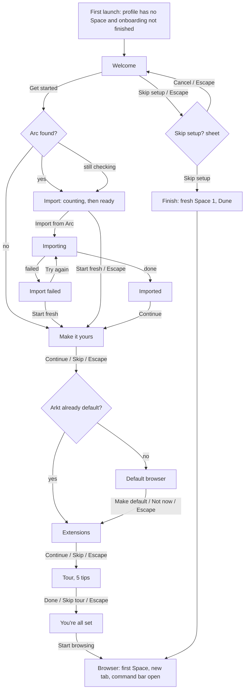
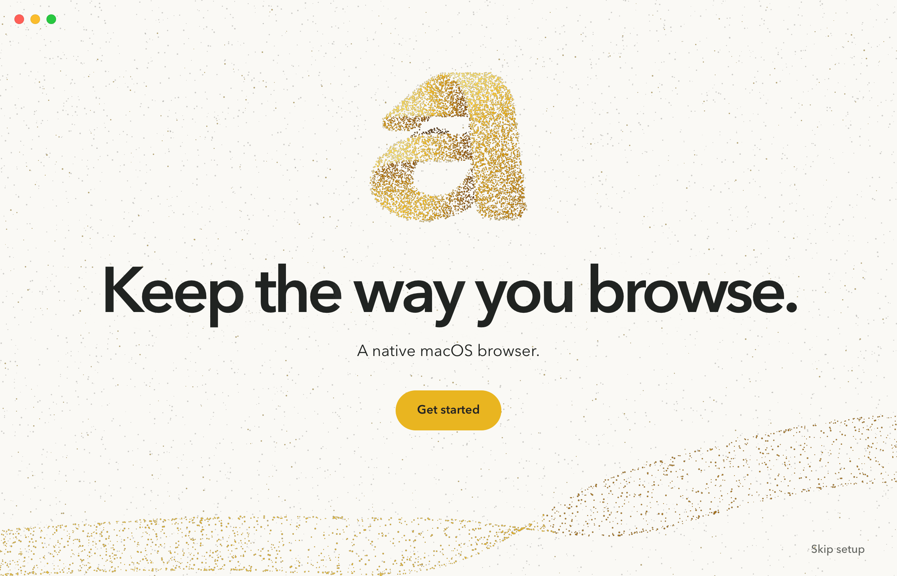
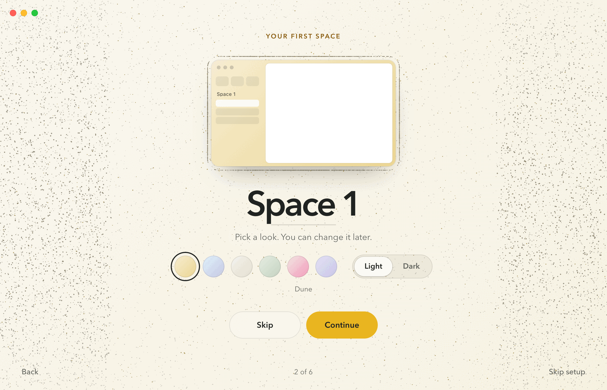
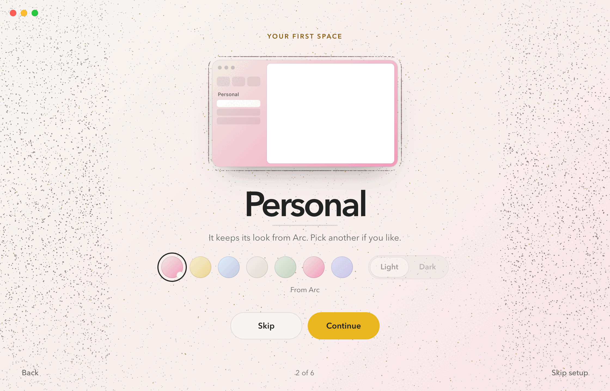
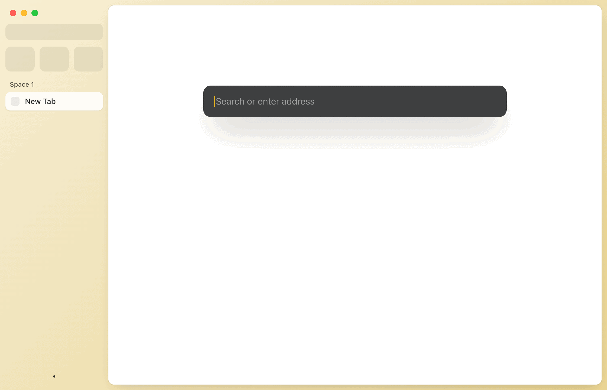
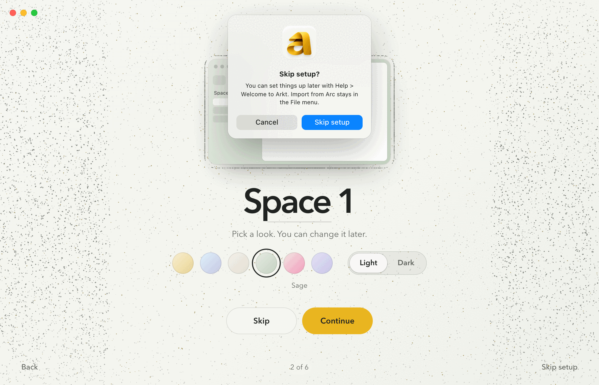

# Onboarding: first-run experience

Design for issue #303. This document is the spec for the native implementation (#310). The clickable prototype in
[`design/onboarding/prototype/`](../../design/onboarding/prototype/) shows the same layout, copy and motion for
review. Where the two disagree, this document wins.

Status: design. Nothing here is implemented yet.

## Contents

- [Decisions](#decisions)
- [1. Idea](#1-idea)
- [2. Flow](#2-flow)
- [3. Type](#3-type)
- [4. Layout](#4-layout)
- [5. Tokens](#5-tokens)
- [6. Steps](#6-steps)
- [7. Particle field](#7-particle-field)
- [8. Motion](#8-motion)
- [9. Reduce Motion, Reduce Transparency, Increase Contrast](#9-reduce-motion-reduce-transparency-increase-contrast)
- [10. Keyboard](#10-keyboard)
- [11. VoiceOver](#11-voiceover)
- [12. Help > Welcome to Arkt](#12-help--welcome-to-arkt)
- [13. State and persistence](#13-state-and-persistence)
- [14. Parity with Arc](#14-parity-with-arc)
- [15. Implementation dependencies](#15-implementation-dependencies)
- [16. Screenshots](#16-screenshots)
- [17. Prototype](#17-prototype)

## Decisions

Maintainer decisions of 2026-10-25. The first two drafts (a centred card wizard inside the browser window, set in
the system font) were rejected as generic. Three directions were then drawn from the arkt.dev design language, and
**Hero** was picked (see [`design/onboarding/README.md`](../../design/onboarding/README.md) for the history).

| # | Question | Decision |
|---|---|---|
| 1 | Live count before import, or import then show? | **Live count before importing**, from a read-only counting pass |
| 2 | Make it yours after an import? | **Yes.** It applies to the first imported Space and starts on a selected "From Arc" swatch |
| 3 | Name 1Password in the extensions step? | **No.** "Your password manager's extension" |
| 4 | Tour length | **Five tips.** Command-L is folded into the first |
| 5 | Default first-Space theme | **Dune** |
| 6 | Should Skip setup confirm? | **Yes.** Confirming drops any theme preview |
| 7 | First-launch window size | **At least 1000 x 680 pt**, clamped to the screen's visible frame |
| 8 | Look and experience | **Hero**: every step is the arkt.dev hero. Window-wide brand field, Avenir Next at the website's scale, the website's pill buttons, one particle field as the stage |

Changes the Hero layout makes to the earlier spec, for review:

- The flow is window-wide. There is no content card and no ghost sidebar during setup; the browser appears only at
  the end, when the field folds onto the card (section 8, M8).
- Progress dots are replaced by a quiet "2 of 6" in the footer, between Back and Skip setup.
- On Make it yours, the Space name is the headline itself: an editable field at display size. The **icon picker is
  dropped** from the first run (the Space menu sets an icon later), to keep the screen to one decision. Restore it
  as a row under the swatches if the icon must be chosen here.
- Tour illustrations are particle formations (key caps, rooms, windows). The CSS key caps and demos of the first
  draft remain only as the no-particle fallback.

## 1. Idea

The first minute in Arkt should look like the website people saw before installing. The window opens as the
arkt.dev hero: porcelain (or graphite) from edge to edge, one particle field, and one centred message at the
website's scale. Every step is that hero again. The shape above the words is the step's subject, made of motes from
real things: the mark sampled from its artwork, the live counts of your Arc sidebar, your first Space in its theme,
the keys and gestures being taught. Controls are few and quiet: one mustard pill, one glass pill, and small text
links at the window's edge.

The flow ends in the browser. On "Start browsing" the field folds onto the edge of the content card, the browser
window shows through, and the command bar opens.

## 2. Flow



| Condition | Effect |
|---|---|
| Arc found (Arc's sidebar file exists) | Import is shown and starts counting at once |
| Arc not found | Import is left out; Make it yours is the first step ("1 of 5", no Back) |
| Arc check still running when Welcome is left | Import is shown counting; if the check then says "no Arc", it is replaced by Make it yours with a normal step change |
| Import path | Make it yours applies to the first imported Space, starts on "From Arc", the name placeholder is that Space's name, Skip keeps the Arc look |
| Start fresh, or failed then Start fresh | Make it yours starts on Dune |
| Arkt is already the default browser | Default browser is left out |
| Skip setup (footer, any step) or Escape on Welcome | Asks first (section 6.9). Confirm drops a theme preview. With no import: a fresh "Space 1" in Dune. After an import: no Space is added. During an import: no Space is added; the import finishes, then the browser opens on the first imported Space (or a fresh "Space 1" if it fails) |

Every step has a secondary action (Start fresh, Skip, Not now, Skip tour); Escape runs it. An import in progress is
the only thing Escape does not interrupt. Progress counts the steps after Welcome on the current branch: 6 with Arc
on either path, 5 without, one fewer when Arkt is already the default browser. The tour is one step.

## 3. Type

The first run is set in **Avenir Next**, the website's face, at the website's scale. It ships with macOS in
`/System/Library/Fonts` (a core system font, not an on-demand download), so the app uses it by PostScript name and
**never bundles or redistributes it**: it is a Monotype face licensed to Apple for use on the Mac.

- Faces: `AvenirNext-Regular` (400), `AvenirNext-Medium` (500), `AvenirNext-DemiBold` (600), via
  `NSFont(name:size:)`.
- Fallback: if a face is missing, `NSFont.systemFont(ofSize:weight:)` at the same size and weight, and the layout
  keeps working.
- Tracking is set per size as `.kern` (points = em value x size), never one value for all sizes. Display lines use
  a paragraph style with a fixed line height (size x leading).
- Text inside the browser chrome (sidebar, toolbar, command bar) stays on the system font. Only first run, About and
  other brand moments use Avenir Next (see `design/brand/README.md`).

| Role | Face | Size / leading | Tracking | Colour |
|---|---|---|---|---|
| Welcome title | DemiBold | 80 / 0.92 | -0.055 em | `brandTextPrimary` |
| Step title | DemiBold | 64 / 0.92 | -0.055 em | `brandTextPrimary` |
| Import title | DemiBold | 54 / 0.92 | -0.055 em | `brandTextPrimary` |
| Space name field (Make it yours) | DemiBold | 64 / 1.02 | -0.055 em | `brandTextPrimary`, caret `accentText` |
| Count, large (pinned tabs) | DemiBold | 210 / 0.86 | -0.04 em | drawn by particles; tabular figures |
| Count, row (Spaces, Favorites, folders) | DemiBold | 64 / 0.86 | -0.04 em | drawn by particles; tabular figures |
| Lede | Regular | 18 / 1.5, max 40 characters a line | 0 | `brandTextSecondary` (Welcome: 20, `brandTextPrimary`) |
| Eyebrow | DemiBold | 12, uppercase | +0.16 em | `accentText` |
| Count label | DemiBold | 11 (13 under the large count), uppercase | +0.16 em | `brandTextSecondary` |
| Button | DemiBold | 15 | +0.005 em | `onAccent` on mustard, `brandTextPrimary` on glass |
| Back, Skip setup | Medium | 14 | 0 | `brandTextSecondary` |
| Progress ("2 of 6") | Regular | 13, tabular | +0.01 em | `brandTextSecondary` |
| Option pill (extensions) | Medium | 15 | 0 | `brandTextPrimary` |
| Theme name under the swatches | Regular | 13 | 0 | `brandTextSecondary` |

Text over the field gets a soft halo in the surface colour (three shadows: 32, 12 and 2 pt blur at 95, 80 and 60 %
of `surfaceBrand`) instead of a card behind it, as on the website. Native: `NSShadow` on the text layers; it is
static, never animated.

## 4. Layout

All sizes in points. Reference window 1120 x 720 pt.

```
+--------------------------------------------------------------------------------+
| o o o                                                                          |
|                              EYEBROW (12, tracked)                             |
|                     +--------------------------------------+                   |
|                     |        stage 560 x 236               |  particle shape   |
|                     +--------------------------------------+                   |
|                          Step title, 64 / 0.92                                 |
|                      Lede, 18 / 1.5, at most 40 characters                     |
|                         [ Secondary ]  [ Primary ]                             |
|                                                                                |
|  Back                              2 of 6                          Skip setup  |
+--------------------------------------------------------------------------------+
```

| Element | Spec |
|---|---|
| Window | At least 1000 x 680 pt, clamped to the visible frame. Full-size content, transparent title bar, traffic lights over the brand surface at their standard place |
| Surface | `surfaceBrand` from edge to edge (porcelain, graphite in dark). No card, no sidebar during setup |
| Column | Centred, text centred. Top padding 58 (Welcome 84) |
| Eyebrow | First line when the step has one (Import, Make it yours, tour) |
| Stage | 560 x 236, 14 below the eyebrow. The step's particle shape lives here and may overflow it (streams, rings, rising field). Welcome: 220 x 200 at the top; Make it yours: the Space preview, 340 x 196 |
| Title | 16 below the stage (Welcome 44, Import 30) |
| Lede | 16 below the title |
| Controls | 20 to 22 below the lede (swatches, option pill) |
| Buttons | 30 below what precedes them, 10 apart, secondary left, primary right (macOS order). Primary is the default button |
| Footer | 16 from the bottom, 26 from the sides: Back (left), progress (centre), Skip setup (right). Hidden pieces keep their place so nothing shifts |
| Compact | When the window is shorter than 700 pt: top padding 46 (Welcome 70), stage 196 high, step titles 56, Welcome 72, counts 176 / 56, name field 56, buttons 24 below, Space preview 300 x 168. Nothing scrolls at 1000 x 680 or at 1000 x 620 |

**Buttons** are the website's pills:

| Button | Spec |
|---|---|
| Primary | 50 high, min width 132, padding 26, fully round. Fill `accent`, hover `accentHighlight`, pressed `accentPressed`, label `onAccent` |
| Secondary | Same size. Glass: `surfaceBrand` at 55 % with a 12 pt background blur and a 1 pt inner `brandHairline`. Hover `surfaceBrand` at 85 %, pressed `brandControlFillPressed` |
| Back, Skip setup | 34 high, padding 14, fully round, no fill; hover `brandControlFill` and `brandTextPrimary`, pressed `brandControlFillPressed` |
| Option pill | 46 high, `brandControlFill` with a hairline, a 20 pt round check that fills mustard with a graphite tick |
| Disabled | Label and fill at 40 %, no hover, no press scale, not the default button |
| Press | Scale 0.97 for 160 ms ease-out (swatches 0.95); under Reduce Motion only the pressed fill |
| Focus | 2 pt `focusRing`, 3 pt outside (3 pt wide with Increase Contrast) |

## 5. Tokens

Brand colours from `BrandTokens`: `surfaceBrand` (porcelain #FAF9F5 / graphite #202321), `accent` (#E9B520),
`accentHighlight` (#F3CA3D), `accentPressed` (#DCA319), `onAccent` (graphite), `accentText` (#8A5A0E / mustard),
`focusRing` (graphite / mustard). Mustard is a fill only: never text or a ring on porcelain.

New `BrandTokens`, with `BrandTokensTests` covering every pair:

| Token | Light | Dark | Contrast | Use |
|---|---|---|---|---|
| `brandTextPrimary` | #202321 | #FAF9F5 | 15.06:1 | Titles, labels on glass |
| `brandTextSecondary` | #62655F | #B6BAB3 | 5.62:1 / 8.06:1 | Ledes, eyebrow-free labels, footer |
| `brandTextSecondaryContrast` | #3D403B | #E3E6DF | 10.1:1 / 12.9:1 | `brandTextSecondary` under Increase Contrast |
| `brandHairline` | graphite 12 % | porcelain 12 % | decorative | Glass edge, option pill edge |
| `brandHairlineContrast` | graphite 45 % | porcelain 50 % | 3:1 or more | Hairlines under Increase Contrast |
| `brandControlFill` | graphite 5 % | porcelain 6 % | n/a | Hover, option pill, segmented track |
| `brandControlFillPressed` | graphite 10 % | porcelain 12 % | n/a | Pressed fills |

Theme families for the first Space (`SpaceThemeCatalog`), two-stop gradients from top left to bottom right, Dune
first and the default. Each stop pair must pass `ShellTokensContrastTests` before it ships.

| Family | Light | Dark |
|---|---|---|
| Dune (default) | #F7EED2 to #EBD592 | #3D3420 to #1E1A10 |
| Mist | #E0F2FB to #C5C6E2 | #3A4158 to #1C2030 |
| Paper | #F4F1EA to #E4DDD2 | #3A3631 to #211F1C |
| Sage | #E6EDE3 to #C4D3C0 | #2F3B33 to #171E1A |
| Blossom | #F2EAE4 to #F29BBB | #4A2A3A to #1F1520 |
| Indigo | #E4E2F4 to #C9C3E8 | #2D4468 to #120F2E |

## 6. Steps

Copy is final. Sentence case; "Arkt" in sentences, the lowercase wordmark only as artwork. Counts use plural rules
("1 Space", "1 pinned tab").

### 6.1 Welcome



| | |
|---|---|
| Shape | The mark, 92 % of its 220 x 200 stage, sampled from `01-mustard-on-white.png` (formation `mark`), and the brand fold sweeping along the bottom of the window (`fold`) |
| Title | Keep the way you browse. |
| Lede | A native macOS browser. |
| Buttons | **Get started** |
| Footer | Skip setup only |
| Accessibility | Group "Welcome to Arkt"; the stage is an image labelled "Arkt" |

### 6.2 Import

The live count is the sculpture, built the way the website builds its countdown: pinned tabs large, Spaces,
Favorites and folders in a smaller row, each number made of motes that re-form whenever it changes. The numbers are
also real text for accessibility (drawn transparent over the field, visible without it).

| State | Eyebrow | Title | Note | Buttons |
|---|---|---|---|---|
| Counting | Looking at Arc on this Mac | Bring it all across. | Arc stays as it is. | Start fresh, Import from Arc (disabled). Numbers rise as the pass finds items |
| Ready | Found in Arc on this Mac | Bring it all across. | Arc stays as it is. | Start fresh, **Import from Arc** |
| Importing | Importing from Arc | Bringing it across. | Arc stays as it is. | Start fresh (disabled), Importing... (disabled). Each category's number turns mustard and its label gets a tick as it lands, in the importer's real order |
| Imported | From Arc | Your Arc setup is here. | All of it came over. Arc stays as it is. Plus "{n} items couldn't be imported." only when some were skipped | **Continue**. Every label ticked |
| Failed | Arc on this Mac | Couldn't import from Arc. | Arkt couldn't read Arc's data. Try again, or import later from File > Import from Arc. | Start fresh, **Try again**. The numbers scatter into a loose cloud and the labels hide |

Counts only: no Space names, titles, URLs or paths. The first-run import shows Imported instead of the
File > Import from Arc summary alert; the menu command keeps its alert. Back is hidden while importing.

### 6.3 Make it yours



| | |
|---|---|
| Eyebrow | Your first Space |
| Shape | A true-colour preview of the Space (340 x 196, radius 14): the theme gradient, the sidebar with three Favorites, the Space title and rows, a page. Around it, the field outlines the preview and rises in the margins in the theme's colours (formation `theme`). The window takes a faint wash of the gradient (22 % light, 16 % dark, 12 % with Reduce Transparency) |
| Name | The headline is the Space name: a text field at display size, placeholder "Space 1" (import path: the imported Space's name), 40 characters at most. A 120 pt hairline under it turns mustard and widens to 180 when focused. Typing updates the preview's title live |
| Lede | Fresh: "Pick a look. You can change it later." Import: "It keeps its look from Arc. Pick another if you like." |
| Theme | Six round swatches, 40 pt, 12 apart (Dune, Mist, Paper, Sage, Blossom, Indigo); on the import path a seventh, "From Arc", comes first with a small badge. Selected: a 2 pt `focusRing` ring 5 pt outside. Radio group, arrow keys move the selection. The theme's name sits under the row |
| Appearance | Segmented pill "Light" / "Dark" beside the swatches: track `brandControlFill`, thumb `surfaceBrand` with a hairline. Starts at the system appearance. Disabled (40 %) while "From Arc" is selected |
| Buttons | Skip, **Continue** |

Choosing a swatch or appearance repaints the preview at once, re-tints the field from the pressed swatch outward
(P6) and changes the wash. Skip restores what the step opened with and drops the preview; Continue keeps it. A
confirmed Skip setup also drops it. The Space is created (fresh) or updated (import) when the step is left.



### 6.4 Default browser

| | |
|---|---|
| Shape | The mark, 150 pt, with mustard motes streaming in from the window's left edge: links from other apps (`def`) |
| Title | Open links in Arkt. |
| Lede | Links from other apps open here. macOS asks you to confirm, and System Settings can change it later. |
| While the system prompt is up | "macOS is asking you to confirm. Arkt continues either way." |
| Buttons | Not now, **Make default** |

Left out when Arkt is already the default. Whatever the answer, the flow moves on when the prompt closes.

### 6.5 Extensions

| | |
|---|---|
| Shape | The mark inside three tilted rings of clusters orbiting slowly, a third of them mustard: the website's extension rings (`ext`) |
| Title | Your extensions work here. |
| Lede | Arkt installs them from the Chrome Web Store. Your password manager's extension is there too. |
| Option | Option pill "Open the Chrome Web Store when setup ends", off by default |
| Buttons | Skip, **Continue** |

No password manager is named. Nothing opens mid-setup; with the option on, the Web Store is the first tab at the end.
The step appears only in builds that run the Chromium engine.

### 6.6 The tour

Five tips, one at a time. The eyebrow reads "Tip {n} of 5"; buttons are Skip tour and **Next** ("Done" on the last).
Back steps through the tips before leaving the tour.

| # | Title | Lede | Shape | Parity rows |
|---|---|---|---|---|
| 1 | Open a tab. | Press Command-T to search or type an address. Command-L edits the address of the current tab. | Two key-cap pairs, Command T and Command L (`tour1`) | KB-001, KB-002 |
| 2 | Close by archiving. | Command-W closes a tab and keeps it in the Archive, so you can find it again. | Command W, with a mustard stream from the keys into an archive tray (`tour2`) | KB-008 |
| 3 | Switch Spaces. | Swipe left or right with two fingers on the sidebar to move between Spaces. | Three Space rooms in Dune, Mist and Blossom paging over twice, resting on the second (`tour3`) | GS-001, BH-035 |
| 4 | Split the view. | Drag a tab from the sidebar onto the page to see two tabs side by side. | A window whose page is split in two; a mustard chip flows from a sidebar row into the right pane (`tour4`) | GS-011, BH-117 |
| 5 | Keep Favorites close. | Drag a tab to the top of the sidebar to make it a Favorite. | A window whose third Favorite fills mustard as a chip flows up into it (`tour5`) | GS-008, BH-047 |

Key caps are 72 pt rounded squares (radius 16) with a heavier bottom edge; the Command glyph is sampled from the
system font and the letters from Avenir Next. The stages of tips 1 and 2 are images labelled "Command T, Command L"
and "Command W".

### 6.7 You're all set

| | |
|---|---|
| Shape | The mark, 168 pt, with a slow mustard orbit, and the fold along the bottom again (`doneMark`) |
| Title | You're all set. |
| Lede | To see this again, choose Help > Welcome to Arkt. |
| Buttons | **Start browsing** |
| Footer | Empty |

### 6.8 Landing in the browser



The field folds onto the content card's edge (M8). The browser shows through: the sidebar is live in the chosen
theme, a current "New Tab" Today row, the command bar open with the field focused. With the Web Store option on,
the first tab is the Chrome Web Store and the command bar stays closed. After an import, the current Space is the
first imported Space; a new tab is still opened and focused.

### 6.9 Skip setup



An `NSAlert` run as a sheet on the onboarding window, informational style, with the app icon.

| | |
|---|---|
| Message | Skip setup? |
| Informative text | You can set things up later with Help > Welcome to Arkt. Import from Arc stays in the File menu. |
| Buttons | **Skip setup** (default, Return), Cancel (Escape) |

Cancel returns to the same step with focus where it was. Step-level secondary actions never ask.

## 7. Particle field

The website's particle system (arkt.dev: `design/website.md` "Particles", `src/scripts/world.js`) is the stage of the
whole flow. One field carries every step; every step is a shape made of it; shapes come from real things; motes keep
moving inside each shape; the mark appears only as particles sampled pixel by pixel from the approved PNG, never
redrawn; mustard appears as sparks and streams.

### 7.1 Layering

From back to front: the theme wash (Make it yours only), the browser (hidden until M8), the **particle layer**
(whole window), the step content, the footer, the traffic lights, sheets. Text and controls are never under motes
because every shape has a reserved stage; where a stream passes behind text, the text halo keeps it legible. The
particle layer never receives events, focus or accessibility.

### 7.2 Formations

N = 20,480 on Apple Silicon (the prototype uses 16,000). Lanes of the particle index (index mod 20) split each
formation into parts, as on the website. Ink is `brandTextPrimary`; mustard is `accent`.

| Formation | Step | Shape, from real things | Parts (share of N) |
|---|---|---|---|
| `mark` | Welcome | The mark, each mote a pixel of `01-mustard-on-white.png` at 140 px (alpha above 200, saturation above 70: 6,622 samples), with sub-pixel jitter | mark 55 %, fold 15 %, field 30 % |
| `fold` | Welcome, Import, Done | The brand fold: a mustard ribbon sweeping along the bottom of the window and flipping once, shaded like the artwork | as listed |
| `count` | Import | The four counts set in Avenir Next DemiBold, sampled from real type at the laid-out positions; mustard sparks inside. Counting: ink at 55 %. Importing: finished categories mustard. Failed: a loose cloud over the stage | digits 55 % (pinned 46 % of those, the others 18 % each), fold 15 %, field 30 % |
| `theme` | Make it yours | An outline around the preview and a field rising in the margins, in the theme's gradient (darkened 38 % over porcelain, lightened 45 % over graphite), sparse mustard sparks | outline 20 %, rising 35 %, sparks 5 %, field 40 % |
| `def` | Default browser | The mark at 150 pt, and mustard streams from the window's left edge into it | mark 35 %, streams 15 %, field 50 % |
| `ext` | Extensions | The mark at 104 pt inside three tilted elliptical rings of 18 clusters each, orbiting in alternate directions, a third mustard | mark 20 %, rings 40 %, field 40 % |
| `tour1` | Tip 1 | Key caps Command T and Command L | caps 55 %, sparks 5 %, field 40 % |
| `tour2` | Tip 2 | Key caps Command W, an archive tray, a mustard stream between them | caps 40 %, tray 10 %, stream 10 %, field 40 % |
| `tour3` | Tip 3 | Three Space rooms (outline, fill in the theme's light stops, three Favorites, four rows) | rooms 75 %, field 25 % |
| `tour4` | Tip 4 | A window: outline, sidebar strip with rows and Favorites, page split into two panes (the right one mustard), a mustard chip stream | window 50 %, stream 10 %, field 40 % |
| `tour5` | Tip 5 | The same window; its third Favorite is filled mustard, a chip stream rises into it | window 50 %, stream 10 %, field 40 % |
| `doneMark` | Done | The mark at 168 pt, a mustard orbit, the fold | mark 45 %, orbit 5 %, fold 15 %, field 35 % |
| `card` | Finish | The content card's edge, sparse mustard on it, a faint fill | edge 60 %, fill 15 %, rest fades |
| field | every step | The website's background field: ink motes at 20 %, mustard sparks at 65 % for one in seven | as listed |

Shapes are built from the live layout when their step appears, at the views' resting positions (not in-flight
transforms), so counts, copy length and the compact layout are respected.

### 7.3 Motion of the field

Each mote springs toward its target and carries its velocity. A new formation never restarts anything: each mote
switches to its new target after a stagger of `seed x 0.55 s` and springs on from where it is, so every change is
interruptible. Targets either rest with a small drift (0.6 to 1.6 pt in shapes, 12 to 24 pt in the field) or ride a
path (streams, orbits, rising, paging).

| ID | Trigger | What moves | Spec |
|---|---|---|---|
| P1 Gather | Welcome shown | A loose cloud gathers into `mark` and `fold` | `gather` spring (damping 0.88, response 0.8 s), stagger 0.55 s; readable by about 1.2 s |
| P2 Break into the count | Get started (Arc found) | The mark's motes become the digits of the live count | `firmSlow` for digit motes, stagger from left to right over 0.35 s; the field keeps `firmExtraSlow` |
| P3 Step change | Any step change | Previous formation to the next | `gather` for shapes, `firmExtraSlow` for the field, stagger 0.55 s |
| P4 Digits re-form | A count changes | Only that number's motes retarget to the new glyph; motes already travelling keep their velocity and stagger | Retarget, never restart. Natively, re-form on each real update, at most 12 times a second |
| P5 Category lands | Importing | That number's motes take mustard (colour eases at 3.4/s); on Imported they return to ink with denser sparks | Colour only; positions unchanged |
| P6 Re-tint | Swatch or appearance change | The new theme colours spread from the pressed swatch at 900 pt/s: each mote switches when the ring reaches it | Stagger = distance / 900 pt/s; the preview's own crossfade takes 0.28 s |
| P7 Streams and orbits | Default, Extensions, tips 2, 4, 5, Done | Motes ride their path at 0.15 to 0.55 cycles/s (orbits 0.025 to 0.04), fading in and out along it | Continuous while the step rests |
| P8 Room paging | Tip 3 shown | Rooms pan one room at +1.4 s, again at +3.0 s, back to the second at +4.6 s, then rest | Exponential ease at 4/s |
| P9 Fold onto the card | Start browsing, confirmed Skip setup | Current formation to `card`; the field fades out from +0.9 s at 6/s; the layer stops and is released | `gather`, stagger 0.3 s |
| P10 Idle | Any step at rest | Drift and paths as above | Continuous; paused per 7.5 |

`gather` (0.88, 0.80 s) is a new `SpringPreset` for formations; all other values are the existing presets.

### 7.4 Native implementation (Metal)

- **Layer:** a layer-backed `NSView` hosting a `CAMetalLayer`, framed to the window's content bounds, between the
  browser layer and the step content. `pixelFormat .bgra8Unorm`, `framebufferOnly = true`, `isOpaque = false`,
  `contentsScale` = the window's backing scale.
- **Data:** per particle a float4 target (x, y, mode, path id), float4 path parameters, float4 colour; state in two
  ping-pong buffers (position and velocity, colour and size). The current and next formation are built off the main
  thread from layout rects when a step appears (about 1 MB each at N = 20,480); only the shown formation is
  rebuilt. Mark samples and glyph samples are cached for the session.
- **Per frame:** one compute kernel (one thread per particle, threadgroups of 256) evaluates the target (rest,
  stream, orbit, rising, pan), integrates the spring with the frame's real `dt` (clamped to 1/30 s, sub-stepped to
  1/240 s), eases colour and size, and writes the next state; then one draw of N point sprites with the soft disc
  (smoothstep 0.5 to 0.18). Alpha blending on porcelain, additive on graphite.
- **Timing:** `NSView.displayLink(target:selector:)`, preferred frame rate range 80 to 120 Hz, preferred 120. The
  CPU sets uniforms only.
- **Budget (Apple Silicon, 2x, 120 Hz):** GPU at most 1.0 ms per frame on M1 (compute about 0.1 ms, draw about
  0.4 ms), CPU at most 0.3 ms per display-link callback. `ShellSignposts` intervals around each frame and Metal
  System Trace verify it; the frame-pacing probe must show no new hitches.
- **Fallback tier:** N = 8,192 at 60 Hz in Low Power Mode, at serious or critical thermal state, on Intel GPUs, or
  after 30 consecutive frames over 2 ms of GPU time.
- **No particle layer:** if Metal is unavailable or setup fails, the flow works unchanged: the raster mark on
  Welcome, Default browser, Extensions and Done; the counts as Avenir Next text; the CSS-style key caps and demos of
  the first draft in the tour; the browser appears with a 240 ms fade.
- **Pause:** no frames while the window is occluded, miniaturized or hidden, or under Reduce Motion once a change has
  settled. The layer and its buffers are released at the end of P9 and rebuilt by Help > Welcome to Arkt.

### 7.5 Accessibility of the field

The particle view is not an accessibility element, never accepts first responder and returns nil from `hitTest`.
Every fact a shape shows is also text: the counts, the titles and ledes, the theme name, and labels on the stages
of Welcome, Done and tips 1 and 2.

## 8. Motion

Springs come from `Motion/SpringPreset`; durations use the strong ease-out `cubic-bezier(0.23, 1, 0.32, 1)`. Nothing
uses ease-in. Every transition retargets from the presented value when interrupted.

| ID | Trigger | What moves | Spec |
|---|---|---|---|
| M1 Welcome reveal | Window first shown | P1; the title resolves word by word; lede, button and footer follow | Words: opacity 0 to 1 and a 0.18 em rise, 700 ms ease-out, 45 ms apart, from +120 ms. Lede +300 ms, button +420 ms |
| M2 Step change | Continue, Skip, Next, Back, arrows | Outgoing content: opacity to 0, 200 ms. Incoming: eyebrow, then the title word by word, then lede, controls and buttons (+300, +360, +420 ms). The field runs P3 | Incoming 700 ms ease-out per element. No lateral travel: the field's change shows the step changed |
| M3 Count rising | Import shown | Numbers update as the pass reports; P4 per change | Prototype: a 1.6 s ease-out sample; native: real progress |
| M4 Category lands | Each import category finishes | P5; the label's tick pops in | Tick `springyFast` from scale 0.8 |
| M5 Imported | Import done | Eyebrow, title and note change; P5 back to ink | Text crossfade 200 ms |
| M6 Theme preview | Swatch, appearance | Preview gradient crossfade, wash, swatch ring (opacity and scale 0.92 to 1), segmented thumb, P6 | Crossfade 0.28 s; ring 160 ms opacity, 220 ms scale; thumb 300 ms `cubic-bezier(0.32, 0.72, 0, 1)` |
| M7 Name field | Focus | The underline widens 120 to 180 and turns mustard | 300 ms ease-out |
| M8 Finish | Start browsing, confirmed Skip setup | Content out; P9; the browser fades in at +650 ms; the command bar at +900 ms; the field fades from +900 ms | Content 160 ms ease-out; browser 240 ms ease-out; command bar opacity 200 ms and scale 0.97 to 1 over 260 ms |
| M9 Press | Any button or swatch | Scale 0.97 (swatches 0.95) with the pressed fill | 160 ms ease-out |
| M10 Skip setup sheet | Skip setup, Escape on Welcome | The system sheet animation | System |

The prototype adds an 8 to 10 px blur to the word reveal, as the website does. Natively, words are separate text
layers laid out once, animated by opacity and position only; no blur, no text re-layout and no frame or constraint
change happens during an animation. Keyboard navigation runs the same transitions as clicks: this is a
once-per-install flow, not a frequent shortcut.

`ShellSignposts` intervals wrap M2 and M8 so the frame-pacing checks cover them.

## 9. Reduce Motion, Reduce Transparency, Increase Contrast

| Setting | Variant |
|---|---|
| Reduce Motion (`accessibilityDisplayShouldReduceMotion`) | Nothing travels. On a change each mote fades out of the old shape and reappears in place in the new one (alpha from 0 at 9/s, stagger `seed x 0.3 s`): the shapes cross-dissolve in about half a second. Drift, streams, orbits, rising and paging stop (paths show a still frame; tip 3 rests on the second room). P6 becomes the same in-place dissolve. Text crossfades in 200 ms with no rise or blur. Presses keep the pressed fill only. The browser appears at once in M8 |
| Reduce Transparency | The faint background field is not drawn; formation motes draw at least at 60 % alpha and 15 % larger; no additive blending on graphite. The glass secondary button and the command bar are opaque. The theme wash drops to 12 % |
| Increase Contrast | Formation motes draw at least at 80 % alpha; on porcelain, mustard motes use `foldShadow` (#A96E12, 4.4:1). `brandTextSecondaryContrast` and `brandHairlineContrast` replace the regular tokens; the glass button gets a 1.5 pt border in `brandTextSecondaryContrast`; focus rings are 3 pt |

Settled frames are the same with and without Reduce Motion, so the step screenshots cover both; screen 26 shows the
dissolve.

## 10. Keyboard

| Key | Action |
|---|---|
| Return | The step's primary (default) button. In the Name field, Return moves on like Continue |
| Escape | The step's secondary action. On Welcome: asks to Skip setup. While importing: nothing. In the sheet: Cancel |
| Escape in the Name field | Ends editing and restores the value it had on focus; a second Escape runs Skip |
| Left arrow | Back, or the previous tip |
| Right arrow | Only returns to a step or tip visited before a Back; never commits a choice |
| Arrows inside controls | In the Name field, the swatches, the segmented control and the option pill, arrows belong to the control and never change the step |
| Tab, Shift-Tab | Reading order (section 11); Back and Skip setup are in the loop |
| Space | Presses the focused button, toggles the option |

The primary button is the default button on every step, so Return works without Tab.

## 11. VoiceOver

One group labelled "Welcome to Arkt" holds the current step; its value reads "Step {n} of {total}". On each step
change, post `layoutChanged` with the title as the focused element.

Reading order: eyebrow, title, lede, controls, secondary, primary, then Back, progress and Skip setup.

| Element | Role | Label / value |
|---|---|---|
| Welcome and Done stage | image | "Arkt" |
| Count | static text | "37 pinned tabs"; while counting "Pinned tabs, counting"; after import "37 pinned tabs, imported" |
| Space name | text field | "Name", placeholder read as "Space 1" |
| Swatch | radio button | "Dune", "Mist"... "From Arc" |
| Appearance | radio group | "Light", "Dark" |
| Web Store option | checkbox | "Open the Chrome Web Store when setup ends" |
| Tip 1, 2 stage | image | "Command T, Command L", "Command W" |
| Tips 3 to 5 stage | hidden | (the lede says it) |
| Sheet | alert (system) | "Skip setup?", the informative text, "Skip setup", "Cancel" |

Announcements: when counts arrive ("Found 4 Spaces, 37 pinned tabs, 12 Favorites and 9 folders."), when the import
starts ("Importing from Arc."), when it ends ("Imported from Arc." or the failure title), and at the end ("Setup
finished. The command bar is open."). Identifiers in `AXID.Onboarding`: root, each step, each button.

## 12. Help > Welcome to Arkt

"Welcome to Arkt" is the first item of the Help menu; no shortcut. Re-entry runs the same flow over the frontmost
window: the brand field covers the window (the page is not unloaded), Import says "Arkt adds what's new in Arc.
Spaces already in Arkt stay as they are." and then shows Imported, Make it yours edits the current Space (Skip
restores it), Default browser is left out when Arkt is already the default, and Done reads "You're all set." /
"Nothing else changed." / **Back to browsing**, returning to the open tab with no new tab and no command bar.

## 13. State and persistence

- Shown automatically when the window's profile has no Space and `onboardingCompletedVersion` is below 1. Profiles
  with Spaces never see it automatically; later windows with no Space keep the existing empty state.
- The current step is saved as the user moves on. Quitting mid-flow resumes there on the next launch, without M1; a
  finished import stays imported and shows Imported.
- `onboardingCompletedVersion` is written on Start browsing and on a confirmed Skip setup.
- Only one window runs the flow.

## 14. Parity with Arc

| Topic | Arc | Arkt | Note |
|---|---|---|---|
| Tour content | BH-211: "Open your first tab", "Pin tabs to save for later", "Spaces for work and life", "Multitask with Split View", "Favorites keep your most used sites and apps close" | Five tips: open a tab (with the address), archiving, Spaces, Split View, Favorites | PARITY(NEEDS-RUNTIME-CHECK) on order and interactivity. Arkt teaches archiving instead of pinning |
| Keys and gestures | KB-001, KB-002, KB-008, GS-001, GS-008, GS-011 | Taught as in Arc | The behaviours exist; only the teaching is new |
| Default browser | BH-129 suggests Arc's first run touches it | One optional step, system prompt | PARITY(NEEDS-RUNTIME-CHECK) |
| Account | Reported to be required | No account step | Deliberate |
| Import source | Reportedly other browsers too | Arc only (Chromium profiles are #131) | Deliberate for now |
| Theme | Reportedly a colour pick | Make it yours | Arkt's own theme set |
| Visual style | n/a | The arkt.dev hero | Arkt's own design; not a parity target |

## 15. Implementation dependencies

1. **Count-only pass** in `ArcImportCoordinator` (Spaces, pinned tabs, Favorites, folders), nothing written, counts
   only, reporting progress so the numbers can rise.
2. **Per-category completion** from the importer for M4. Without it, all categories land together at the end.
3. **Default browser registration**: URL schemes and document types in Info.plist,
   `NSWorkspace.setDefaultApplication(at:toOpenURLsWithScheme:)`, and a check to leave the step out.
4. **Theme catalog**: the six families, Dune first and the default, passing `ShellTokensContrastTests`.
5. **Brand tokens** from section 5, with `BrandTokensTests`.
6. **Brand type**: a small `BrandType` helper that resolves Avenir Next by PostScript name with the system-font
   fallback and applies the per-size tracking and leading from section 3.
7. **Help menu item** and an `AppCommands` action that starts the flow on the key window.
8. **Engine-only step**: a build-configuration check for Extensions.
9. **Window frame**: at least 1000 x 680 pt, clamped to the visible frame, full-size content view.
10. **Particle layer** per section 7.4, and the `gather` spring preset.

## 16. Screenshots

Rendered from the prototype with the project's Chromium build, headless, 1120 x 720 pt at 2x (2240 x 1440 px;
31 and 32 are the compact 1000 x 680), quantized to 256 colours. All files are in
[`design/onboarding/screens/`](../../design/onboarding/screens/), as `{name}-light.png` and `{name}-dark.png`.

| # | Screen | Light | Dark |
|---|---|---|---|
| 01 | Welcome | [light](../../design/onboarding/screens/01-welcome-light.png) | [dark](../../design/onboarding/screens/01-welcome-dark.png) |
| 02 | Import, counting | [light](../../design/onboarding/screens/02-import-counting-light.png) | [dark](../../design/onboarding/screens/02-import-counting-dark.png) |
| 03 | Import, ready | [light](../../design/onboarding/screens/03-import-light.png) | [dark](../../design/onboarding/screens/03-import-dark.png) |
| 04 | Importing | [light](../../design/onboarding/screens/04-importing-light.png) | [dark](../../design/onboarding/screens/04-importing-dark.png) |
| 05 | Imported | [light](../../design/onboarding/screens/05-imported-light.png) | [dark](../../design/onboarding/screens/05-imported-dark.png) |
| 06 | Import failed | [light](../../design/onboarding/screens/06-import-failed-light.png) | [dark](../../design/onboarding/screens/06-import-failed-dark.png) |
| 07 | Make it yours, fresh | [light](../../design/onboarding/screens/07-theme-light.png) | [dark](../../design/onboarding/screens/07-theme-dark.png) |
| 08 | Make it yours, after an import | [light](../../design/onboarding/screens/08-theme-after-import-light.png) | [dark](../../design/onboarding/screens/08-theme-after-import-dark.png) |
| 09 | Make it yours, no Arc (first step) | [light](../../design/onboarding/screens/09-theme-no-arc-light.png) | [dark](../../design/onboarding/screens/09-theme-no-arc-dark.png) |
| 10 | Default browser | [light](../../design/onboarding/screens/10-default-light.png) | [dark](../../design/onboarding/screens/10-default-dark.png) |
| 11 | Extensions | [light](../../design/onboarding/screens/11-extensions-light.png) | [dark](../../design/onboarding/screens/11-extensions-dark.png) |
| 12 | Tip 1, Open a tab | [light](../../design/onboarding/screens/12-tour-1-light.png) | [dark](../../design/onboarding/screens/12-tour-1-dark.png) |
| 13 | Tip 2, Close by archiving | [light](../../design/onboarding/screens/13-tour-2-light.png) | [dark](../../design/onboarding/screens/13-tour-2-dark.png) |
| 14 | Tip 3, Switch Spaces | [light](../../design/onboarding/screens/14-tour-3-light.png) | [dark](../../design/onboarding/screens/14-tour-3-dark.png) |
| 15 | Tip 4, Split the view | [light](../../design/onboarding/screens/15-tour-4-light.png) | [dark](../../design/onboarding/screens/15-tour-4-dark.png) |
| 16 | Tip 5, Keep Favorites close | [light](../../design/onboarding/screens/16-tour-5-light.png) | [dark](../../design/onboarding/screens/16-tour-5-dark.png) |
| 17 | You're all set | [light](../../design/onboarding/screens/17-done-light.png) | [dark](../../design/onboarding/screens/17-done-dark.png) |
| 18 | Skip setup sheet (over Make it yours, Sage previewed) | [light](../../design/onboarding/screens/18-skip-confirm-light.png) | [dark](../../design/onboarding/screens/18-skip-confirm-dark.png) |
| 19 | Landing in the browser | [light](../../design/onboarding/screens/19-browser-light.png) | [dark](../../design/onboarding/screens/19-browser-dark.png) |
| 20 | Key: Welcome to Import, 350 ms (the mark breaking into the count) | [light](../../design/onboarding/screens/20-key-welcome-to-import-350ms-light.png) | [dark](../../design/onboarding/screens/20-key-welcome-to-import-350ms-dark.png) |
| 21 | Key: Welcome to Import, 800 ms (the count rising) | [light](../../design/onboarding/screens/21-key-welcome-to-import-800ms-light.png) | [dark](../../design/onboarding/screens/21-key-welcome-to-import-800ms-dark.png) |
| 22 | Key: digits re-forming as the count rises, 300 ms | [light](../../design/onboarding/screens/22-key-count-rising-300ms-light.png) | [dark](../../design/onboarding/screens/22-key-count-rising-300ms-dark.png) |
| 23 | Key: re-tint, 300 ms after picking Sage | [light](../../design/onboarding/screens/23-key-retint-300ms-light.png) | [dark](../../design/onboarding/screens/23-key-retint-300ms-dark.png) |
| 24 | Key: Finish, 450 ms (folding onto the card) | [light](../../design/onboarding/screens/24-key-finish-450ms-light.png) | [dark](../../design/onboarding/screens/24-key-finish-450ms-dark.png) |
| 25 | Key: Finish, 900 ms (the browser shows through) | [light](../../design/onboarding/screens/25-key-finish-900ms-light.png) | [dark](../../design/onboarding/screens/25-key-finish-900ms-dark.png) |
| 26 | Reduce Motion: Welcome to Import, 200 ms (in-place dissolve) | [light](../../design/onboarding/screens/26-reduce-motion-welcome-to-import-200ms-light.png) | [dark](../../design/onboarding/screens/26-reduce-motion-welcome-to-import-200ms-dark.png) |
| 27 | Reduce Transparency: Import | [light](../../design/onboarding/screens/27-reduce-transparency-import-light.png) | [dark](../../design/onboarding/screens/27-reduce-transparency-import-dark.png) |
| 28 | Reduce Transparency: Make it yours | [light](../../design/onboarding/screens/28-reduce-transparency-theme-light.png) | [dark](../../design/onboarding/screens/28-reduce-transparency-theme-dark.png) |
| 29 | Increase Contrast: Import | [light](../../design/onboarding/screens/29-increase-contrast-import-light.png) | [dark](../../design/onboarding/screens/29-increase-contrast-import-dark.png) |
| 30 | Increase Contrast: Tip 1 | [light](../../design/onboarding/screens/30-increase-contrast-tour-1-light.png) | [dark](../../design/onboarding/screens/30-increase-contrast-tour-1-dark.png) |
| 31 | Compact (1000 x 680): Make it yours | [light](../../design/onboarding/screens/31-compact-theme-light.png) | |
| 32 | Compact (1000 x 680): Import | [light](../../design/onboarding/screens/32-compact-import-light.png) | |

## 17. Prototype

Serve the repository root with any static server, or open `design/onboarding/prototype/index.html` straight from
disk (the mark samples are embedded and the scripts are classic, so both work).

- `?s=` jumps to a screen: `welcome`, `import-counting`, `import`, `importing`, `imported`, `import-failed`,
  `theme`, `theme-after-import`, `theme-no-arc`, `default`, `extensions`, `tour-1` to `tour-5`, `done`, `browser`,
  `skip-confirm`.
- `?theme=light|dark` forces the appearance; `?rm`, `?rt` and `?ic` force Reduce Motion, Reduce Transparency and
  Increase Contrast (the system settings are honoured too); `?arc=0` runs the no-Arc branch; `?default=1` leaves
  out the Default browser step.
- `?still=1` settles the field and freezes time for captures; `?settle=1` starts settled but running, for
  keyframes.
- The field is WebGL2 standing in for the Metal layer, with the same spring model, lanes and formations.
  Stand-ins: the import's timing is simulated, the system default-browser prompt is not shown, and the Skip setup
  sheet is drawn in HTML.
