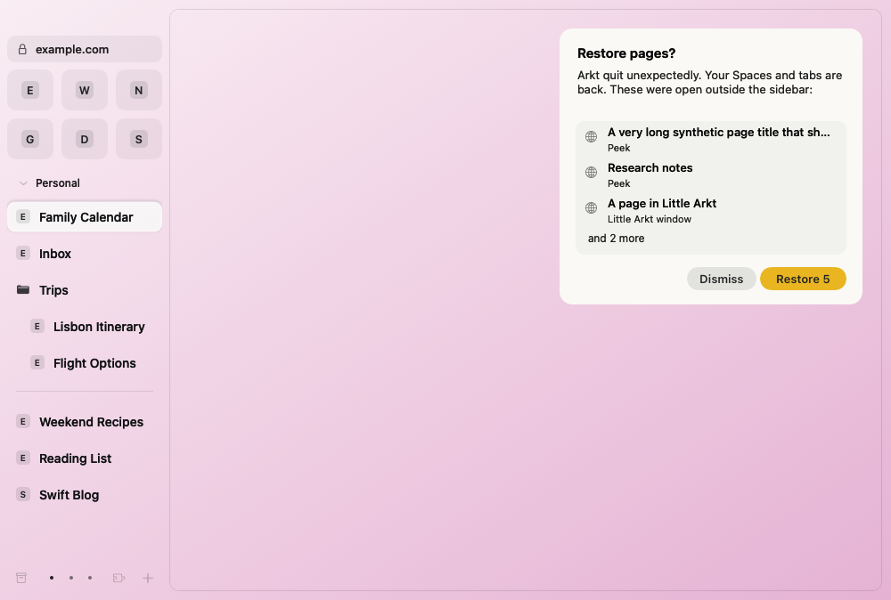
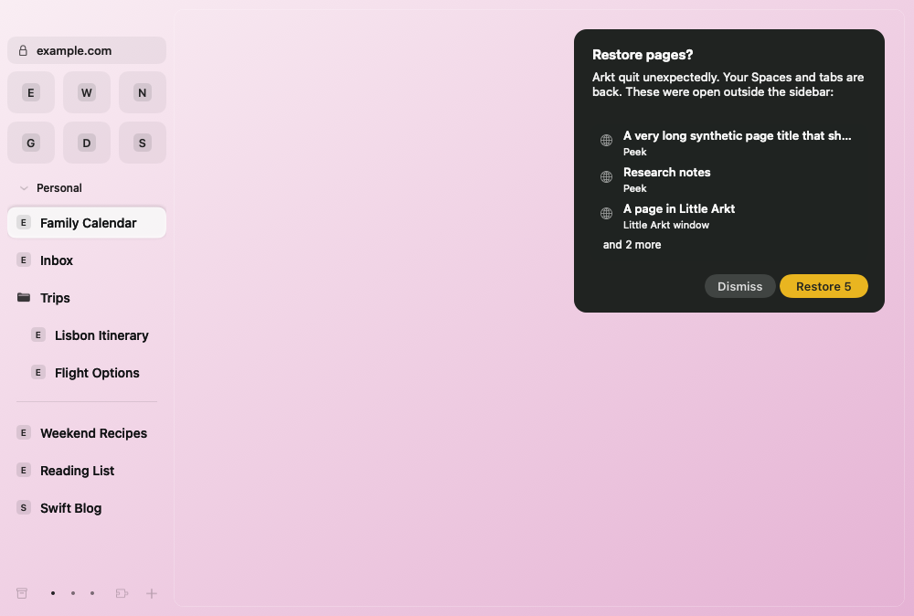

# Restore pages evidence (#580)

Captured by `RestorePagesScreenshotTests` at `1c110df9d2fa72077ce16a5ea776c0d76f6b9e0b`
in [CI run 42385504787](https://github.com/krystianslowik/arkt/actions/runs/42385504787).
Each 1000 × 674 PNG shows window content rendered through AppKit, using synthetic sidebar and recovery pages.
The images apply Aqua and Dark Aqua window appearance; the synthetic Space theme is the same in both.
They exercise a long title, three visible rows, overflow and the Restore count.

Both captures completed successfully and were visually inspected. These images do not establish keyboard,
VoiceOver, Reduce Motion or real killed-process behavior. See PR #690 for the remaining validation.
